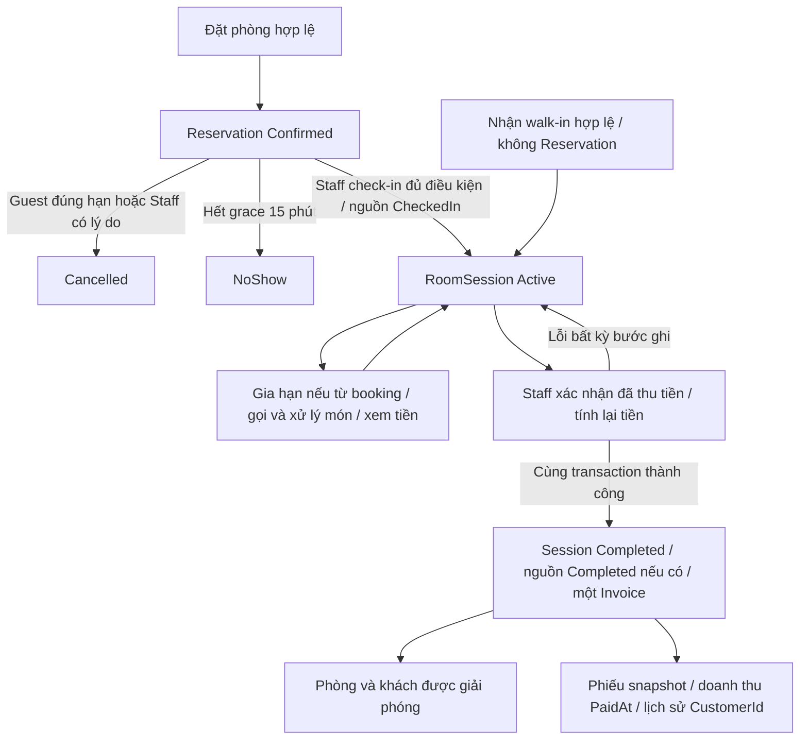

# Đối chiếu luồng nghiệp vụ hiện hành — 24/10/2026

## Kết luận và phạm vi

Lượt chỉnh nhập liệu/menu trước đó không phải một lần kiểm toán lại mọi đường chạy. 43 bộ SQLite/WPF và 15 bộ MySQL đạt ở lượt trước là bằng chứng theo các ca đã viết, không bảo đảm mọi tổ hợp nghiệp vụ đều đúng. Lượt này đọc lại quy tắc, đường service và bổ sung kiểm tra ghép các bước thành một lượt khách hoàn chỉnh.

**App/worker đang chạy SQLite v8. MySQL v1 mới port đến 04e.3, chưa có chuỗi Guest → Order → Checkout → Invoice → Report đầy đủ.** Không ghép kết quả SQLite và MySQL để tuyên bố chuỗi MySQL hoàn tất. Không thay provider, schema hoặc dữ liệu thật trong lượt rà soát này.

Nguồn: plan WPF hiện hành, `Reference_Web_ProjectPlan_v1.3.md` mục 4–33, 38–48, 54–56 và 59; code trong Services/ViewModels/Views, các bộ test và bảng `MySql_Migration_Status.md`. Không áp dụng ASP.NET/SQL Server của tài liệu web vào nền tảng WPF.

## Ma trận nghiệp vụ và bằng chứng

“Đối chiếu” dưới đây nghĩa là đọc đường xử lý và kiểm tra bằng chứng của chức năng, không có nghĩa đã thử mọi tổ hợp đầu vào trên giao diện thật hoặc dữ liệu thật.

| Nhóm | Quy tắc phải giữ | Đường xử lý đã đối chiếu | Bằng chứng |
|---|---|---|---|
| Đăng nhập/RBAC | Tài khoản active, stamp hiện hành, role → permission; Staff không báo cáo, quản trị chỉ Admin | AuthenticationService, PermissionService, AccountManagementService, PermissionManagementService | Authentication, Accounts, PermissionMatrix, UI; Workflow thử thu hồi CheckOut rồi khôi phục qua service |
| Danh mục phòng/loại | Standard/VIP cố định Code; giá/sức chứa/tiện ích hợp lệ; ảnh thật hợp lệ; không khóa khi còn booking/Active; giữ lịch sử | RoomTypeService, RoomService, RoomImages | RoomTypes, Rooms, UI; Workflow tạo hai phòng qua service và đổi giá/tên loại sau check-in |
| Danh mục món | Nhóm cố định, giá nguyên đồng dương, ngừng bán thay xóa; không sửa snapshot món cũ | ServiceCatalogService, OrderService | Services, Orders, UI; Workflow đổi tên/giá/ngừng bán sau khi đã gọi |
| Đặt trước/đặt hộ | UTC+7 hôm nay..+30; slot 30 phút; duration 60/90/120/180; nằm một ca; overlap Room/Customer; Confirmed, không cọc | GuestBookingService/StaffBookingService → ReservationService → BookingHours/AvailabilityService | Availability, Reservations, GuestBooking, StaffBooking, GuestCalendar; Workflow đặt và đọc lại Day/Week |
| Hủy/NoShow | Guest ≤ Start−2h; Staff cần lý do, Confirmed còn hạn; hết grace tại đúng +15; worker không tạo session | GuestReservationService.Cancel, ReservationService.CancelStaff, NoShowService | GuestLookup, StaffReservations, Reservations, CheckIn; Workflow exact 2h, dưới 2h, thiếu lý do, +15 và worker lặp |
| Check-in | Quyền CheckIn hiện hành; đủ duration từ giờ nhận thật; grace/ca/Room/Customer; một session; replay không ghi mới | RoomSessionService.CheckIn → AvailabilityService.CheckCheckInAt | CheckIn, UI, Workflow nhận lúc 13:07:12 và gọi lặp |
| Walk-in | Không Reservation/duration/ExpectedEnd; một Active Room/Customer; future booking được; ReturnBy theo ca và lịch Room/Customer, không tự checkout | RoomSessionService.CreateWalkIn/ReadWalkIn, ScheduleRules | WalkIn, Availability, Calendar, UI; Workflow thêm hai booking tương lai và kiểm tra hạn trả theo Customer |
| Gia hạn | Chỉ Active từ booking, +30/+60, trước/đúng ExpectedEnd, cùng ca, không trùng Room/Customer; không đổi Reservation/giá | GuestSessionService, RoomSessionService.ExtendStaff, StaffSessionService | Extension, GuestSessions, Sessions, UI; Workflow gia hạn Guest, giữ EndTime booking, từ chối walk-in |
| Gọi/phục vụ/hủy món | Guest Pending, Staff tạo hộ Completed sau phục vụ; chỉ Pending đổi trạng thái; current phone/Active/ca; món snapshot; 1–10 mỗi món | OrderService và GuestOrders/StaffOrders/StaffOrderCreate VM | Orders, UI; Workflow gồm Guest phục vụ, Staff tạo hộ, hủy Guest và Pending lúc checkout |
| Tiền tạm tính | actual ticks/decimal, không block giờ, AwayFromZero; chỉ Completed; read không thu tiền/kết thúc | BillingService.ReadGuest/ReadStaff/CalculateActive | Billing, UI; Workflow kiểm tra 90 giây = 3.000đ, cộng 75.000đ món, doanh thu vẫn 0 |
| Thanh toán | Confirm tính lại now/món; Cash/BankTransfer; hủy Pending, Session/Reservation/Invoice/audit cùng transaction; replay một hóa đơn | CheckoutService.PreviewStaff/ConfirmStaff | Checkout, UI; Workflow preview 79.000đ → Confirm 81.000đ, lỗi audit rollback toàn bộ rồi retry |
| Hóa đơn/in | Một invoice/session; bất biến; tên/giá phòng/món từ snapshot, nhân viên lúc thu; quyền View/Print riêng | InvoiceService, InvoicePrint VM/Window | Invoices, InvoicePrinting, UI; Workflow ReadForPrint đối chiếu snapshot sau đổi danh mục, không gửi máy in |
| Dashboard/lịch | Trạng thái hiện tại tách giữ lịch; không tự kết thúc; cảnh báo; Day/Week cùng rule; doanh thu theo quyền/PaidAt | DashboardService, CalendarService, ScheduleRules; MainWindow reload sau modal | Dashboard, Calendar, UI; Workflow kiểm tra phòng trả về Available và tổng thu theo role |
| Báo cáo/Excel | PaidAt/đúng ngày UTC+7/bộ lọc; phòng, booking, món/top10 theo nguồn tương ứng; View+Export, Staff bị chặn | ReportService, RoomUsageReportService, BookingStatusReportService, ServiceSalesReportService, ReportExcelWriter | RevenueReport, RoomUsageReport, BookingStatusReport, ServiceSalesReport, RevenueExcel, ReportTablesExcel và UI; Workflow nối hóa đơn mới vào report/export |
| Lịch sử khách | Liên kết CustomerId, không chuỗi SĐT; giữ snapshot/phòng khóa; đếm Completed; invoice theo quyền | CustomerHistoryService/VM/Window | CustomerHistory, CustomerHistoryUi; Workflow đổi số khi Active rồi đối chiếu lịch sử sau checkout |

Ranh giới quan trọng: các writer giữ kiểm tra lại trong transaction; tắt nút/preview không phải cơ chế bảo đảm chống trùng. SQLite dùng writer transaction của provider; các writer MySQL đã port có thứ tự khóa và test online riêng. Các test race hiện có vẫn là bằng chứng cho cạnh tranh; bài Workflow mới chạy chuỗi tuần tự, không thay thế chúng.

## Ba chuỗi kiểm tra mới



NoShow/Cancelled không chuyển ngược thành Confirmed hoặc CheckedIn. Khách đến sau NoShow có thể tạo **walk-in mới** khi đủ điều kiện. ExpectedEndTime/ReturnBy chỉ là mốc dự kiến/cảnh báo, không phải cạnh chuyển tự động sang Completed. Chỉ món Completed vào tiền; Pending còn lại bị hủy khi checkout cùng transaction.

`Tests/WorkflowChecks.cs` dùng **cùng một database tạm**, cùng IClock, Admin/Staff/Manager tạo qua service tài khoản, phòng có ảnh tạo qua RoomService và món tạo qua ServiceCatalogService. Không UPDATE trạng thái nghiệp vụ hoặc INSERT Invoice để giả lập kết quả. SQL trực tiếp chỉ đọc đối chiếu và thêm/bỏ trigger gây lỗi kiểm tra rollback.

### A. Đặt trước đến thu tiền và lịch sử

1. Guest xem phòng → preview → tạo Confirmed → tra cứu số chuẩn hóa; lịch Day/Week cùng thấy booking.
2. Staff nhận lúc 13:07:12 cho booking 13:00–14:00: ExpectedEnd = 14:07:12. Gọi check-in lại trả cùng session.
3. Guest gia hạn +30 đến 14:37:12; EndTime booking vẫn 14:00.
4. Guest gọi hai món rồi Staff phục vụ; Staff ghi thêm một món đã phục vụ; Guest hủy một đơn khác; còn một Pending.
5. Sau 90 giây, tiền phòng 3.000đ + ba món 75.000đ. Pending/Cancelled không cộng.
6. Sửa SĐT khách qua service: số cũ không thấy Active/không gọi món tiếp được; số mới thấy đúng phiên.
7. Sửa giá/tên loại phòng và tên/giá/trạng thái món: snapshot cũ vẫn dùng.
8. Preview lúc 13:09:12 là 79.000đ, chưa sinh doanh thu.
9. Confirm lúc 13:10:12: cố tình lỗi ghi audit Invoice.Create. Kiểm tra session vẫn Active, nguồn CheckedIn, đơn vẫn Pending, không invoice và không log ghi dở.
10. Bỏ lỗi rồi Confirm: 81.000đ, dựa giờ mới; Pending bị hủy; session/booking Completed. Gọi lại với phương thức khác trả invoice cũ, không đổi cách thu tiền.
11. Guest không còn Active/Confirmed nguồn; phiếu in giữ giá 120.000đ/giờ và món Trà 25.000đ; báo cáo/dashboard Manager bằng tiền invoice; Staff không thấy doanh thu tổng hợp.
12. Lịch sử theo CustomerId thấy Completed/invoice/snapshot; room trở lại Available; export báo cáo tạo dữ liệu XLSX. Tính đúng nội dung Excel chuyên sâu do các bộ Excel riêng kiểm tra.

### B. Walk-in gặp booking tiếp theo

Nhận trực tiếp 16:00 tại phòng 2 → đặt trước phòng 2 lúc 17:00 cho khách khác vẫn được → khách walk-in đặt hộ phòng 1 lúc 16:30 cũng được → ReturnBy đổi thành 16:30 theo Customer. Đúng 16:30 chưa checkout thì check-in phòng 1 bị từ chối dù phòng 1 trống. Walk-in không gia hạn. Checkout 16:31 giải phóng Customer, lúc đó check-in booking phòng 1 được và giữ đủ duration. Thanh toán phiên sau; hủy booking phòng 2 dưới 2h bằng Guest bị chặn, Staff phải nhập lý do.

### C. Hủy, hết grace và quyền hiện hành

Guest hủy đúng mốc Start−2h thành công. Booking khác đến đúng Start+15 không check-in được; lịch bỏ hold trước khi worker chạy. Worker cập nhật đúng một NoShow, gọi lại không tạo thêm thay đổi. Khách đến muộn được nhận bằng walk-in mới khi đủ điều kiện, không khôi phục booking NoShow. Admin thu hồi CheckOut qua ma trận quyền: phiên Staff đang đăng nhập bị từ chối ngay; khôi phục quyền qua service rồi checkout được. Cuối chuỗi kiểm tra quan hệ Completed/Invoice, một Active mỗi Room/Customer và FK.

## Các điểm phát hiện và xử lý

| Điểm | Kết luận/xử lý |
|---|---|
| Dễ nhầm test nhiều với đã kiểm toán hết | Ghi rõ nguồn bằng chứng theo từng nhóm và bổ sung chuỗi liên service, không tuyên bố đúng 100% mọi tổ hợp |
| Bản use case 11/10 chứa trạng thái “chưa có” đã cũ | Giữ bản đó làm snapshot lịch sử; thêm liên kết nổi bật tới báo cáo hiện hành này |
| MySQL chưa đủ nghiệp vụ | Là đầu việc thật còn lại trong migration, không phải chức năng đã hoàn tất; tiếp 04e.4 rồi Order/Billing/Checkout/Invoice/quản trị/báo cáo/lịch sử và import/UI/cutover |
| Dashboard chưa có timer tự refresh | Không phải lệch MVP: mục 29 yêu cầu nút làm mới/reload sau thao tác, mục 59 ghi timer là tùy chọn; không tự thêm phạm vi |
| Guest dùng SĐT không OTP | Quy ước đã chốt tại mục 22; giữ current phone/Active/public DTO, không tự đổi nghiệp vụ xác thực |
| Lỗi quy tắc runtime trong ba chuỗi mới | Chưa phát hiện trong ca đã chạy; không đổi production service chỉ để tạo cảm giác đã “sửa toàn bộ” |
| Máy in/dữ liệu thật/cutover | Chưa nghiệm thu trong lượt này; ReadForPrint không có nghĩa đã in giấy hoặc vận hành MySQL thật |

## Cách kiểm tra và điều kiện làm tiếp

```powershell
powershell.exe -NoProfile -ExecutionPolicy Bypass -File .\Tests\Verify-Workflows.ps1 -BuildDirectory .\MusicBoxManagement.Wpf\bin\Debug
powershell.exe -NoProfile -ExecutionPolicy Bypass -File .\Tests\Verify-All.ps1 -BuildDirectory .\MusicBoxManagement.Wpf\bin\Debug
```

Build trước khi chạy. Runner All tự nhận thêm Workflows: hiện **44 bộ SQLite/WPF**, cộng **15 bộ MySQL đã port** khi dùng IncludeMySql. Không coi 59 bộ là 59 use case độc lập hoặc tất cả đều kiểm tra MySQL.

Mỗi bước tiếp theo phải chỉ ra mục nghiệp vụ được thực hiện, trạng thái trước/sau, quyền, thời gian/tiền/snapshot/transaction, đường Guest/Staff và ca từ chối/lặp/rollback/cạnh tranh phù hợp. Giữ bảng migration và ma trận này khi port: có schema hoặc service đơn lẻ không đủ để đánh dấu một luồng đầu-cuối đã xong.

## Kết quả kiểm tra lượt này

- Verify-Workflows đạt trên hai bản build Debug/Release đã build ở lượt UI trước; không thay production assembly trong lượt này.
- Chạy lại Verify-All cho runtime SQLite/WPF: **44/44 bộ Debug đạt**, bao gồm AuthenticationUi (140 ảnh), Workflow và các bộ biên/race/rollback/quyền/báo cáo/Excel/lịch sử riêng.
- Log và exit code từng bộ: `TEMP\MusicBoxRegression_15008446883e426abd366ea3b51dabcd\results.json`. Các database/thư mục Workflow GUID được dọn sau test, đường dẫn dọn được kiểm tra nằm trực tiếp trong TEMP.
- MySQL không đổi code và không chạy lại online trong lượt kiểm toán này. Bằng chứng gần nhất cùng ngày: 15/15 bộ MySQL đã port đạt ở lượt trước, ghi trong báo cáo UI và bảng migration. Không có bằng chứng mới cho các service MySQL chưa viết.
- git diff --check đạt. Không nhập dữ liệu thật, không in giấy; thay đổi định dạng csproj từ trước vẫn giữ riêng ngoài commit.
