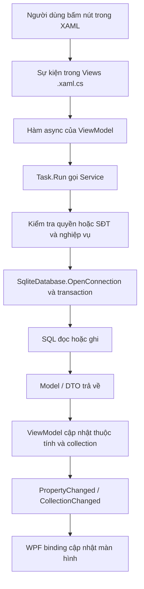

# Luồng code Music Box WPF — lần theo từ giao diện đến SQLite

Cập nhật **14/10/2026**, sau bước **8b.2 UI quản trị tài khoản** và 8a.2 UI dashboard. Đọc cùng [giải thích kiến trúc MVC/MVVM](Architecture_MVC_Services_Explanation.md). Tài liệu này tập trung vào **ai gọi hàm nào, truyền gì, nhận gì, dữ liệu đổi ở đâu**, thay vì chỉ định nghĩa tên các lớp.

Nền tảng: WPF .NET Framework 4.7.2, SQLite v8; Khách dùng tại quầy/demo, nhân viên đăng nhập. Các tên hàm dưới đây đối chiếu với mã nguồn hiện tại. Các dòng “SQL/Commit/binding” trong sơ đồ là bước xử lý, không phải tên lớp tự tạo.

## 1. Nhìn toàn bộ trước khi đi vào từng hàm



Có hai biến thể cần nhớ. Nút menu trên MainWindow thường kiểm tra quyền rồi **mở cửa sổ**, chưa ghi nghiệp vụ. Khi cửa sổ con mở, Loaded mới tải dữ liệu; nút xác nhận của cửa sổ con mới gọi service ghi. Một số ViewModel nhận service qua interface hoặc factory, nên tên `service.Create(...)` thực tế phụ thuộc đối tượng đã truyền vào constructor.

| Thành phần | Công việc trong project | Ví dụ |
| --- | --- | --- |
| XAML | Định nghĩa nút, bảng, binding, hiện/ẩn | `Click="Refresh_Click"`, `Text="{Binding Summary}"` |
| Code-behind | Nhận sự kiện, mở/đóng cửa sổ, gọi ViewModel | `DashboardView.Refresh_Click` |
| ViewModel | Trạng thái form, busy, preview/xác nhận, dữ liệu hiển thị | `DashboardViewModel.RefreshAsync` |
| Service | Quyền, quy tắc nghiệp vụ, transaction, SQL, audit | `DashboardService.Read` |
| Model/DTO | Gói dữ liệu trả về hoặc yêu cầu đầu vào | `DashboardSnapshot`, `ReservationRequest` |
| Data | Connection, schema/migration, Identity store | `SqliteDatabase`, `SqliteIdentityStore` |

Project không có controller HTTP của ASP.NET MVC. Vai trò nhận thao tác nằm ở code-behind và ViewModel; business nằm trong service.

## 2. Luồng khởi động ứng dụng

File bắt đầu: `MusicBoxManagement.Wpf/App.xaml.cs`.

```text
WPF gọi App.OnStartup(e)
  → đặt CurrentCulture/CurrentUICulture = vi-VN
  → new SqliteDatabase(SqliteDatabase.DefaultPath)
  → tạo RoomTypeService và các service dùng chung database
  → new MainViewModel(roomTypes)
  → new MainWindow(... các service ...)
  → MainWindow.Show()
  → new NoShowWorker(database)
  → NoShowWorker.StartAsync()
```

`new SqliteDatabase(...)` là tạo đối tượng chứa cấu hình đường dẫn; các lần Initialize/OpenConnection mới thực hiện phần dữ liệu tương ứng. File thật ở `%LOCALAPPDATA%/MusicBoxManagement.Wpf/musicbox.db`. Các bài test truyền một đường dẫn tạm khác, nên không sử dụng file thật này.

Trong `MainWindow` constructor:

1. `InitializeComponent()` đọc giao diện đã compile từ XAML, tạo các control như StaffPanel, Sidebar, DashboardHost.
2. Lưu các service vào field. Đây là dependency injection thủ công: App tạo service rồi truyền vào; không cần container DI.
3. `DataContext = viewModel` đặt nguồn binding mặc định cho danh mục Khách.
4. Tạo `DashboardViewModel(reservations.ForDashboard)`. Tham số này là **delegate/factory**, chưa phải kết quả đọc dashboard.
5. `DashboardHost.DataContext = dashboard` đặt nguồn binding riêng cho UserControl dashboard. Vì thế binding Summary của dashboard không tìm trong MainViewModel.

Khi Window Loaded:

```text
MainWindow.Window_Loaded
  → MainViewModel.RefreshAsync
      → Task.Run → RoomTypeService.List → SQLite → List<RoomType>
      → RoomTypes.Clear/Add → collection tự báo WPF
  → MainWindow.PrepareLoginAsync
      → Task.Run → AuthenticationService.NeedsSetup
      → đổi nút thành Thiết lập Admin hoặc Đăng nhập nhân viên
```

Lúc này ứng dụng ở chế độ Khách. Chưa có LoginSession; chưa gọi service dashboard cho người chưa đăng nhập.

## 3. Từ nút đăng nhập đến phiên nhân viên

```text
MainWindow.Login_Click
  → AuthenticationService.NeedsSetup
  → new AuthenticationWindow(authentication, needsSetup)
  → ShowDialog()
      → người dùng bấm nút xác nhận
      → AuthenticationWindow.Submit_Click
      → SetupAdminAsync(...) hoặc LoginAsync(userName, password)
      → nhận LoginSession và đóng dialog thành công
  → session = dialog.Session
  → MainWindow.RefreshAccessAsync()
```

`ShowDialog()` mở cửa sổ modal: thao tác trên cửa sổ cha tạm bị chặn. Cửa sổ đăng nhập đọc PasswordBox rồi xóa mật khẩu khỏi control; mật khẩu không đưa vào binding thông thường.

Đối với `AuthenticationService.LoginAsync`:

```text
kiểm tra đầu vào
  → database.Initialize()
  → database.OpenConnection()
  → new SqliteIdentityStore(connection)
  → Manager(store) tạo UserManager
  → manager.FindByNameAsync(userName.Trim())
  → kiểm tra user tồn tại và IsActive
  → manager.CheckPasswordAsync(user, password)
  → new LoginSession(user.Id, user.SecurityStamp)
  → BeginWriteTransaction(connection)
  → PermissionService.ReadAccess(session, connection, transaction)
  → AuditService.WriteStaff(... User.Login ...)
  → transaction.Commit()
  → return session
```

Kiểm tra lại sau băm mật khẩu là cần thiết: xác minh mật khẩu mất thời gian; tài khoản có thể bị khóa hoặc đổi stamp trong khoảng đó. LoginSession là phiên trong bộ nhớ, mang UserId/stamp; quyền và role dùng trong nghiệp vụ vẫn phải đọc DB hiện hành.

SetupAdminAsync là đường tạo Admin đầu tiên trong transaction, có kiểm tra bootstrap đồng thời. Nó **không phải màn quản trị thêm/sửa/khóa mọi nhân viên**. Quản trị đã có service 8b.1 và UI 8b.2 (mục 5.15).

## 4. Luồng dashboard mới — đi từng hàm

### 4.1 MainWindow.RefreshAccessAsync: chuẩn bị màn nhân viên

Được gọi sau đăng nhập, khi bấm **Bảng điều hành** ở sidebar, và khi đóng các màn nghiệp vụ cần cập nhật lại màn chính.

Trình tự:

1. Lấy `currentSession = session` để nhớ chính xác phiên đang xử lý.
2. Nếu chưa có session thì dừng. `await accessGate.WaitAsync()` dùng SemaphoreSlim cho các lần tải quyền chạy tuần tự; sau khi chờ, lấy lại session hiện hành. Không bỏ qua lần tải mới sau khi đóng nghiệp vụ vì lần cũ vẫn đang chạy.
3. `dashboard.Reset(null)` xóa snapshot/số liệu/doanh thu cũ ngay. Tạm khóa StaffNavigation và nút kiểm tra/tải lại.
4. `await Task.Run(() => permissions.GetStaffAccess(currentSession))` đọc tên/role/quyền mới.
5. Nếu `session != currentSession`, bỏ kết quả: người dùng đã chuyển phiên/đăng xuất trong lúc chờ.
6. Điền StaffIdentity, ModeText; hiện/ẩn từng menu theo permission tương ứng. Ví dụ InvoicesButton cần Invoice.View; không dùng Dashboard.View để cấp quyền in.
7. Hiện StaffPanel, ẩn vùng Khách. Có Dashboard.View thì hiện DashboardHost và tiêu đề Bảng điều hành; thiếu quyền thì hiện hướng dẫn chọn menu được phép.
8. Nếu được xem dashboard: `dashboard.Reset(currentSession)` rồi `await dashboard.RefreshAsync()`.
9. `finally` mở lại điều hướng/nút và `accessGate.Release()`. Lỗi xác thực/quyền ở phần đọc access đưa về Guest qua ReturnToGuest; lỗi trong phần dashboard được ViewModel báo và xóa dữ liệu.

### 4.2 Vì sao truyền `reservations.ForDashboard`?

Đoạn khởi tạo:

```csharp
dashboard = new DashboardViewModel(reservations.ForDashboard);
```

`DashboardViewModel` giữ một `Func<LoginSession, DashboardService> create`. Khi gọi:

```csharp
create(current).Read(current)
```

thì thực tế xảy ra hai lời gọi nối nhau:

```text
StaffReservationService.ForDashboard(current)
  → PermissionService.Demand(current, "Dashboard.View")
  → return new DashboardService(database, clock)

DashboardService.Read(current)
  → kiểm tra quyền lại trong read transaction của dashboard
```

Factory không tạo thêm một DB riêng. Nó chuyển đúng database/clock đã được truyền vào StaffReservationService. Kiểm tra ở factory bảo vệ đường mở; kiểm tra trong Read bảo vệ dữ liệu tại lần đọc thật. Không dùng kết quả kiểm tra cũ thay cho kiểm tra mới.

### 4.3 DashboardViewModel.RefreshAsync: chống trùng và gọi background

```text
RefreshAsync()
  → CanRefresh? nếu false thì return
  → current = actor; request = ++version
  → busy = true; Clear(); Changed()
  → await Task.Run(() => create(current).Read(current))
  → kiểm tra request/actor/IsSignedOut
  → lưu DashboardSnapshot
  → đổi DTO thành DashboardLine tiếng Việt, Add vào các collection
  → đặt Status
  → finally: busy = false; Changed() nếu request vẫn là request hiện tại
```

`busy` chặn hai lần tải của cùng phiên. `version` xử lý trường hợp khác: đã bắt đầu đọc, sau đó đăng xuất/đổi người rồi mới nhận kết quả cũ. Reset tăng version, nên lần đọc cũ không có quyền ghi ngược dữ liệu lên UI.

Ví dụ: Admin tải dashboard, tác vụ đang đọc ở background; Admin đăng xuất. Reset(null) xóa doanh thu và tăng version. Khi kết quả Admin về, `request != version`, kết quả bị bỏ. Đây là hủy **việc áp dụng kết quả**, không phải cưỡng bức ngắt câu SQL đang chạy.

`Clear()` xóa snapshot và 5 collection. Nó không tự đổi actor/version. `Reset(session)` gọi Clear, đổi actor, tăng version và đặt trạng thái ban đầu.

### 4.4 DashboardService.Read: dữ liệu thực sự được đọc ở đâu?

```text
database.OpenConnection()
  → connection.BeginTransaction(ReadCommitted)
  → DemandDashboard(actor, connection, transaction)
      → PermissionService.ReadAccess(...)
      → cần Dashboard.View
  → clock.UtcNow.ToUniversalTime() đúng một lần
  → CalendarRange.Day(ngày Việt Nam của now)
  → ReadRooms(connection, transaction, now)
  → ReadBookings(connection, transaction, day, now)
  → ReadSessions(connection, transaction, now)
  → dựng Alerts từ booking/session đã đọc
  → ReadPending(connection, transaction)
  → CanReadRevenue(access)? ReadRevenue(... day) : null
  → return DashboardSnapshot
  → using dispose reader/command/transaction/connection
```

Mỗi helper dùng **cùng connection và transaction**. Không có trường hợp danh sách phiên lấy trước checkout, còn doanh thu lấy sau checkout trong cùng một kết quả. `CheckedAt` là mốc IClock chung để nhân viên biết dữ liệu đã cũ bao lâu.

| Helper | SQL/nguồn | Trả về để làm gì |
| --- | --- | --- |
| ReadRooms | Rooms và CurrentRoomStatus | Phòng/mã/tên/trạng thái hiện tại |
| ReadBookings | Reservations JOIN Rooms | Booking hôm nay và Confirmed còn hiệu lực phục vụ cảnh báo lượt kế tiếp |
| ReadSessions | RoomSessions WHERE Active | Phiên đang dùng; có CustomerId nội bộ để so lịch, không trả CustomerId ra DTO |
| ReadPending | Orders JOIN RoomSessions, Pending + Active | Đơn chờ cần phục vụ |
| ReadRevenue | SELECT TotalAmount FROM Invoices theo PaidAt | Tổng đã thanh toán hôm nay cho người đủ quyền |

`ReadBookings` có thể đọc Confirmed tương lai để tính cảnh báo, nhưng `BookingsToday` trả về chỉ lọc Start trong ngày Việt Nam. Booking hết grace được chiếu NoShow trong DTO; không UPDATE Reservations tại đây.

### 4.5 Hai hàm dùng chung với lịch

`ScheduleRules.CurrentRoomStatus`:

```text
IsActive = false → Inactive
có RoomSession Active → Occupied
có Confirmed đã tới giờ, chưa hết +15 phút → Reserved
còn lại → Available
```

CalendarService và DashboardService cùng gọi hàm này, tránh hai màn tự định nghĩa trạng thái khác nhau.

`ScheduleRules.WalkInReturnBy` lấy mốc đóng ca theo ActualStart, rồi tìm booking Confirmed còn hiệu lực sớm nhất của **Room hoặc Customer**. Nó trả hạn cần trả động; không ghi ExpectedEndTime. Khách có thể đang ở D2 nhưng đặt lượt tiếp ở D1, nên chỉ xét Room là chưa đủ.

### 4.6 Dựng bốn cảnh báo trong Read

| Kind | Điều kiện | Ý nghĩa trên UI |
| --- | --- | --- |
| NearNoShow | `0 < Start +15 phút - now <= 5 phút` | Sắp hết hạn nhận phòng |
| Overdue | `now > ExpectedEnd` hoặc `now > ReturnBy` | Khách quá giờ; đúng giờ trả chưa tính quá giờ |
| NextBooking | Walk-in cần trả trước lượt kế; phiên booking vượt lịch dự kiến hoặc vẫn Active khi lượt sau tới giờ | Nhắc xử lý lượt tiếp của phòng/khách |
| OutsideHours | Active trong giờ nghỉ, từ 23:00, hoặc qua đêm/trước 09:00 | Còn khách ngoài giờ mở cửa |

Cảnh báo là DTO trong bộ nhớ. Không gọi CheckOut/Cancel/Extend/ProcessExpired từ dashboard; người xử lý vẫn phải mở nghiệp vụ đúng quyền.

### 4.7 Doanh thu được bảo vệ hai lớp

`PermissionService.ReadAccess` lọc Report.* khỏi Staff kể cả DB gán nhầm. `DashboardService.CanReadRevenue` lại yêu cầu role **Admin**, hoặc **Manager và Report.View**. Không chỉ hỏi “có chuỗi quyền Report.View không”.

Nếu được đọc: lọc `PaidAt >= đầu hôm nay AND PaidAt < đầu ngày mai`, đọc TotalAmount TEXT và cộng bằng decimal. Không SUM bằng SQLite REAL và không lấy tiền tạm tính. `TodayRevenue = null` là thiếu quyền; `0` là có quyền và chưa có hóa đơn hôm nay.

`ReadRevenueToday(actor)` là API riêng, cũng đòi Dashboard.View và điều kiện role/report. UI dashboard hiện dùng trường TodayRevenue của **Read**, không gọi API riêng lần nữa, để giữ một snapshot/một clock.

### 4.8 Kết quả đi từ service lên control bằng cách nào?

`DashboardSnapshot` chứa dữ liệu nghiệp vụ thô. ViewModel chuyển từng dòng thành `DashboardLine { Title, Detail }` bằng `Line`, `State`, `AlertName`, `Local`:

- `State("Occupied")` → “Đang sử dụng”.
- `AlertName("NearNoShow")` → “Sắp hết hạn nhận phòng”.
- `Local(...)` → giờ UTC+7, HH:mm:ss dd/MM/yyyy.
- `Revenue` → tiền N0 theo vi-VN.

Trong XAML: `Text="{Binding Summary}"` tìm getter Summary trên DashboardViewModel. `ItemsSource="{Binding Rooms}"` tìm ObservableCollection Rooms. Khi Add/Clear, collection tự phát CollectionChanged. Khi snapshot/busy/status đổi, `Changed()` gọi `Notify(...)`, phát PropertyChanged để WPF đọc lại các getter.

Ví dụ Snapshot đổi nhưng không Notify(nameof(Revenue)) thì TextBlock có thể giữ chuỗi cũ. Vì vậy Changed liệt kê cả Revenue/HasRevenue/Summary/Updated/Status. HasRevenue được BooleanToVisibilityConverter biến thành Visible hoặc Collapsed.

### 4.9 Bấm Làm mới và đăng xuất

```text
DashboardView.xaml: Click="Refresh_Click"
  → DashboardView.Refresh_Click
  → lấy DashboardViewModel từ DataContext
  → await model.RefreshAsync()
  → factory + DashboardService.Read + binding như trên
```

Nút Bảng điều hành ở sidebar đi qua `RefreshAccess_Click → RefreshAccessAsync`, cập nhật cả menu/identity/quyền trước tải dashboard. Nút Làm mới trong dashboard cập nhật dữ liệu bằng quyền hiện hành của service; không tự mở cửa sổ nghiệp vụ.

```text
Logout_Click
  → ReturnToGuest
      → authentication.Logout(session)
      → session = null
      → dashboard.Reset(null)
      → ẩn DashboardHost/StaffPanel/menu nội bộ
      → xóa StaffIdentity, hiện giao diện Khách
  → MainViewModel.RefreshAsync
  → PrepareLoginAsync
```

Khi mất quyền dashboard hoặc đọc lỗi, ViewModel Clear dữ liệu rồi báo Status; không tiếp tục hiển thị doanh thu/số liệu cũ. Các menu nghiệp vụ kiểm tra quyền riêng khi mở và service kiểm tra lại khi thao tác.

## 5. Bản đồ gọi hàm của toàn bộ các luồng nghiệp vụ chính

Các chuỗi dưới đây giúp đặt breakpoint theo đúng thứ tự. Dấu ngoặc ghi dữ liệu quan trọng được truyền; không mô tả một hàm khác có cùng tên ở project web.

### 5.1 Khách đặt phòng

```text
MainWindow.ShowBooking_Click → GuestBookingWindow
Loaded → GuestBookingViewModel.RefreshAsync → IBookingService.ListRooms
  → GuestBookingService.ListRooms → PublicRoom của phòng mở
Preview_Click → GuestBookingViewModel.PreviewAsync → Request()
  → GuestBookingService.Preview(ReservationRequest)
  → chuẩn hóa SĐT + availability → ReservationAvailability
Submit → GuestBookingViewModel.SubmitAsync → service.Create(input)
  → GuestBookingService.Create → ReservationService.CreateGuest
  → ReservationService.Create(session=null, request, guest=true)
```

Trong Create: BeginWriteTransaction → kiểm tra input/tên/SĐT → clock sau khi giữ writer → BookingHours.ValidateReservation → NoShowService.ProcessExpiredAt → tìm/tạo Customer theo số chuẩn hóa → AvailabilityService.CheckReservationAt → INSERT Reservation Confirmed → audit Guest → Commit → trả Reservation. ViewModel giữ mã mới và khóa gửi lặp.

Preview không giữ chỗ. Hai người cùng thấy trống vẫn có thể gửi gần nhau; writer sau phải kiểm tra lại overlap Room/Customer trong transaction và có thể bị từ chối.

### 5.2 Nhân viên đặt hộ

```text
ShowStaffBooking_Click → reservations.ForBooking(session)
  → StaffBookingService → GuestBookingWindow(... staffMode=true)
  → GuestBookingViewModel.SubmitAsync → StaffBookingService.Create
  → ReservationService.CreateStaff(session, request)
  → Create(... guest=false)
```

Cùng form/interface IBookingService, khác **service thật**. CreateStaff đòi Reservation.Create, lưu CreatedByUserId/audit Staff; không gọi CreateGuest nếu nhân viên mất quyền. Reservation.View chỉ cần cho màn danh sách, không tự đòi thêm cho người chỉ được đặt hộ.

### 5.3 Tra cứu và hủy booking bằng SĐT

```text
ShowLookup_Click → GuestLookupWindow
Search_Click → GuestLookupViewModel.SearchAsync → ReloadAsync(number)
  → GuestReservationService.Lookup(number)
  → PhoneNumberNormalizer.Normalize
  → NoShowService.ProcessExpired
  → read transaction: Confirmed của SĐT hiện hành
  → GuestSessionService.ReadActiveAt trong cùng read snapshot
  → GuestReservationLookup { Items, ActiveSession, CheckedAt }

Cancel_Click → RequestCancel (chỉ mở xác nhận)
Confirm_Click → ConfirmCancelAsync → GuestReservationService.Cancel(number, id)
```

Cancel kiểm tra lại membership/SĐT, trạng thái, nguồn session và hạn Start−2 giờ trong writer; UPDATE Cancelled + lý do + audit Guest + Commit. Đổi SĐT trên form xóa kết quả cũ, không giữ quyền hủy từ lần tra cứu trước.

### 5.4 Booking nội bộ và nhận phòng

```text
ShowReservations_Click → ReservationsWindow
Loaded/Search_Click → ReservationsViewModel.SearchAsync
  → StaffReservationService.Search(session, dates, phone, status)
  → Reservation.View + bộ lọc → danh sách/chi tiết
CheckIn_Click → RequestCheckIn (mở xác nhận)
ConfirmCheckIn_Click → ConfirmCheckInAsync
  → StaffReservationService.CheckIn → RoomSessionService.CheckIn
```

CheckIn: writer → Session.CheckIn hiện hành → đọc booking/grace/phòng/khách → kiểm tra ca/overlap bỏ nguồn → actual không làm tròn → chốt snapshot giá/phòng → tạo Active/đổi booking CheckedIn/audit → Commit. ExpectedEnd = actual + đủ thời lượng; không cắt thời lượng để nhường booking sau. Replay hợp lệ trả session cũ và vẫn kiểm tra quyền.

Hủy nội bộ: `RequestCancel → ConfirmCancelAsync → StaffReservationService.Cancel → ReservationService.CancelStaff`; cần Reservation.Cancel và lý do, không áp hạn 2 giờ của Guest. Đóng màn Booking tải lại quyền/dashboard trên MainWindow.

### 5.5 Khách trực tiếp — walk-in

```text
ShowWalkIn_Click → ForWalkIn(session) → WalkInWindow
WalkInViewModel.RefreshAsync → RoomSessionService.ListWalkInRooms
PrepareAsync → PreviewWalkIn(actor, WalkInRequest)
ConfirmAsync → CreateWalkIn(actor, request)
  → writer/Session.WalkIn/current clock/ca/phòng/khách
  → tìm/tạo Customer + Active session/snapshot/audit + Commit
  → WalkInResult và ReadWalkInReceipt cho người tạo
```

Không truyền duration. ReservationId và ExpectedEndTime null; ReturnBy là giới hạn động để nhắc trả, không là một booking hoặc hold tương lai. Walk-in không có chức năng gia hạn.

### 5.6 Gia hạn nội bộ

```text
ShowSessions_Click → ForSessions → SessionsWindow
SessionsViewModel.SearchAsync → StaffSessionService.Search (Session.View)
PreviewAsync → StaffSessionService.Preview
  → RoomSessionService.PreviewViewedExtension → PreviewExtensionCore
ConfirmAsync → StaffSessionService.Extend
  → RoomSessionService.ExtendViewedStaff → ExtendStaffCore
```

Đường UI này cần View + Extend. API lõi `PreviewExtensionStaff/ExtendStaff` độc lập View để giữ hợp đồng Session.Extend của service. ExtendStaffCore lấy writer, kiểm tra quyền/current ExpectedEnd so với observedEnd, clock, ca và lịch Room/Customer; chỉ +30/+60 cho Active từ Reservation, trước/đúng ExpectedEnd. UPDATE ExpectedEnd + audit cùng Commit, không sửa snapshot hoặc Reservation gốc.

### 5.7 Gia hạn Guest

```text
GuestLookupViewModel.PreviewExtensionAsync
  → GuestSessionService.PreviewExtension(number, sessionId, minutes)
ConfirmExtensionAsync
  → GuestSessionService.Extend(number, id, observedEnd, minutes)
  → DemandActive + membership/SĐT/status/observedEnd trong writer
  → AvailabilityService.CheckExtensionAt + audit Guest + Commit
  → ReloadAsync(number)
```

Không gọi ExtendStaff và không giả quyền Staff. Nếu đã Commit nhưng reload lỗi, UI phải báo đã gia hạn, không gửi lại cùng yêu cầu vì nghĩ chưa lưu.

### 5.8 Gọi món Guest và xử lý Staff

```text
GuestLookupWindow.Orders_Click → GuestOrdersWindow
GuestOrdersViewModel.ReloadAsync → OrderService.ReadMenuGuest / ListGuest
PreviewAsync → PreviewGuest(number, sessionId, cart)
ConfirmAsync → CreateGuest(number, sessionId, cart) → OrderService.Create

ShowOrders_Click → ForOrders → StaffOrdersWindow
StaffOrdersViewModel.ReloadAsync → ReadWorkspaceStaff
LoadSelectedAsync → ListStaff
ConfirmAsync → ConfirmStaff(orderId) hoặc CancelStaff(orderId)

StaffOrderCreateViewModel.ReloadAsync → ReadMenuStaff
PreviewAsync → PreviewStaff
ConfirmAsync → CreateStaff(actor, sessionId, cart)
```

Create chung: writer → quyền Staff hoặc Guest membership của Active → DemandOrderHours → ReadCart gộp số lượng 1–10, đọc giá/tên server và IsActive → INSERT Orders/OrderItems snapshot → audit → Commit. Guest tạo Pending; nhân viên tạo hộ **Completed cho món đã phục vụ**. Pending Guest đã tồn tại thì xác nhận nó, không tạo thêm đơn hộ trùng.

`ConfirmStaff/CancelStaff/CancelGuest → ChangeState` kiểm tra Pending + Active và quyền/ownership hiện hành trước UPDATE + audit. Pending chưa cộng tiền; Completed mới cộng. Ngừng bán danh mục không xóa món/giá snapshot cũ.

### 5.9 Tiền tạm tính

```text
SessionBillViewModel.RefreshAsync
  → BillingService.ReadGuest(number, sessionId) hoặc ReadStaff(actor, sessionId)
  → ReadActive(connection, transaction, sessionId, phone hoặc null)
  → đọc snapshot RoomSession Active
  → OrderService.ReadOrders
  → clock.UtcNow → UsedTicks
  → RoomCharge(rate, ticks)
  → cộng Order Completed bằng decimal
  → return SessionBill → UI
```

Giá phòng lấy HourlyRate lúc nhận; tiền theo actual, gồm giây/ticks và cả quá giờ. RoomCharge xử lý phần nguyên/phần dư, làm tròn đồng AwayFromZero một lần; không nhân rate×ticks theo cách gây tràn. Không dùng số phút N2 đã hiển thị để tính tiền.

### 5.10 Checkout và tạo hóa đơn

```text
ShowCheckout_Click → ForCheckout → CheckoutWindow
Loaded → CheckoutViewModel.ReloadAsync → ListActiveStaff
Preview_Click → PreviewAsync → CheckoutService.PreviewStaff
  → bill/món Completed/Pending → form xác nhận đã nhận tiền
Confirm_Click → CheckoutViewModel.ConfirmAsync
  → CheckoutService.ConfirmStaff(actor, sessionId, paymentMethod)
```

Trong ConfirmStaff:

1. BeginWriteTransaction; Demand Session.CheckOut.
2. ReadInvoice: nếu đã chốt, trả hóa đơn cũ theo cơ chế replay.
3. Kiểm tra Cash/BankTransfer; `BillingService.CalculateActive` tính **mới** trong cùng writer.
4. ReadAccess lấy tên thu ngân hiện hành để snapshot; dùng BillingEndTime làm actual end/PaidAt.
5. Đọc Pending rồi UPDATE Cancelled; reservation nguồn CheckedIn → Completed; session → Completed và ActualEnd.
6. INSERT Invoice một lần với mã unique, tổng tiền TEXT, payment, tên thu ngân snapshot.
7. ReadInvoice và audit Order.Cancel/Session.CheckOut/Invoice.Create trong cùng transaction.
8. Commit → trả Invoice → ViewModel giữ receipt. MainWindow tải lại dashboard khi đóng cửa sổ.

Preview không chốt giá. Bấm xác nhận phải tính lại vì actual và đơn món có thể đổi. Không tự gọi ngân hàng; BankTransfer là nhân viên xác nhận đã nhận đủ tiền.

### 5.11 Tìm/xem/in lại hóa đơn

```text
ShowInvoices_Click → ForInvoices → InvoicesWindow
SearchAsync → InvoiceService.Search(actor, code, dates, phone)
SelectAsync → InvoiceService.Read → ReadCore(requirePrint=false)
  → CheckoutService.ReadInvoice + session/Completed item snapshots
PreparePrintAsync → InvoiceService.ReadForPrint → ReadCore(requirePrint=true)
  → InvoicePrintViewModel → InvoiceDocument.Create → InvoicePrintWindow
PrintAsync
  → ReadForPrint trước dialog
  → IInvoicePrinter.Select / PrintDialog.ShowDialog
  → nếu hủy: không Send
  → ReadForPrint lại sau xác nhận
  → InvoiceDocument.Create theo vùng in
  → DocumentPaginator.ComputePageCount
  → InvoicePrinter.Send → PrintDialog.PrintDocument
```

ReadCore kiểm tra View; in thêm Print. Dữ liệu lịch sử từ snapshot, không từ giá/tên danh mục hiện tại và không gọi Billing tính lại. Send thành công nghĩa là gửi lệnh tới hệ thống in; không cam kết giấy đã ra. Các bài tự động dùng fake printer.

### 5.12 Lịch nội bộ và trống/bận Guest

```text
ShowCalendar_Click → CalendarDayWindow → CalendarDayViewModel
  → CalendarService.Read(actor, CalendarRange.Day/Week, roomFilter)
  → Calendar.View + read snapshot
  → Populate → CurrentRoomStatus / HoldsSql / actual & expected / WalkInReturnBy
  → RoomSchedule → UI vẽ theo range, tách lane nếu chồng

GuestBookingWindow.Calendar_Click → PrepareCalendarAsync
  → IBookingService.ReadDay(roomId, date, duration)
  → GuestCalendarService.Read hoặc StaffBookingService.ReadDay
  → ô trống/bận public → GuestCalendarWindow
```

Guest không dùng CalendarService nội bộ có PII. Chọn ô trống chỉ điền giờ vào form; không tạo booking/giữ chỗ. Đường Staff vẫn kiểm tra Reservation.Create, không fallback Guest.

### 5.13 Danh mục loại phòng/phòng/dịch vụ/khách

| Màn | Chuỗi đọc | Chuỗi lưu |
| --- | --- | --- |
| Loại phòng | MainViewModel.RefreshAsync → RoomTypeService.List | RoomTypeEditViewModel.SaveAsync → RoomTypeService.Update(actor, original, changes) |
| Phòng | RoomsViewModel.RefreshAsync → RoomService.ListForManagement | CreateAsync → RoomService.Create; RoomEditViewModel.SaveAsync → RoomService.Update |
| Dịch vụ | ServicesViewModel.RefreshAsync → ServiceCatalogService.ListForManagement | SaveAsync → ServiceCatalogService.Save(actor, original, input) |
| Khách | CustomersViewModel.SearchAsync → CustomerService.Search | SaveAsync → CustomerService.Save(actor, original, input) |

Service kiểm tra quyền hiện hành, original để chặn form cũ ghi đè, validation, dữ liệu và audit trong cùng transaction. PhoneNumberNormalizer dùng chung cho khách/booking/lookup. Ảnh phòng là file PNG chuẩn hóa cạnh DB; backup phải giữ cả Content. Không dùng xóa khách/món đang ngừng bán làm cách bỏ lịch sử.

### 5.14 Worker NoShow

```text
App.OnStartup → NoShowWorker.StartAsync → RunAsync
DispatcherTimer.Tick mỗi phút → Tick → RunAsync
  → Task.Run → database.Initialize → NoShowService.ProcessExpired
  → writer/current clock → ProcessExpiredAt → UPDATE hết grace + audit System → Commit
App.OnExit → NoShowWorker.Dispose → dừng timer
```

Worker có guard chạy trùng và retry nhịp sau khi lỗi. Worker ghi NoShow thật; dashboard chỉ chiếu hiệu lực. Dashboard không tự refresh mỗi nhịp worker; timestamp và Làm mới cho biết khi cần cập nhật.

### 5.15 Quản trị tài khoản — UI và service

```text
MainWindow.ShowAccounts_Click → StaffReservationService.ForAccounts
  → Demand(User.Manage) → AccountManagementService → AccountsViewModel
  → AccountsWindow.ShowDialog → Loaded → ReloadAsync → service.List
Chọn dòng → Selection_Changed → Select(UserAccount với Revision)
Thêm/Reset → New_Click/Reset_Click → StartNew/StartReset
Prepare_Click → PrepareAsync → service.List kiểm tra quyền/Revision → confirmation
Confirm_Click → đọc PasswordBox + nhập lại, xóa hai control
  → mismatch? PasswordError, không ghi
  → AccountsViewModel.ConfirmAsync(password)
  → Task.Run → API service như dưới
  → thành công: Clear + List tải lại, Status giữ đã lưu nếu reader lỗi
  → tự reset: RequiresRelogin=true, xóa data, không gọi List bằng phiên cũ
Đóng → MainWindow đọc RequiresRelogin
  → ReturnToGuest/PrepareLoginAsync nếu tự reset
  → RefreshAccessAsync nếu phiên còn hợp lệ
```

Mật khẩu không ở property của ViewModel; chỉ là tham số tạm của thao tác Confirm. Busy guard chặn click lặp/đóng; FormIdentity đổi mới xóa password khi chuyển ngữ cảnh. Prepare giữ bản sao AccountEdit; writer không tin quyền hoặc Revision lúc preview. Bảng active OneWay vì DTO đọc không cho sửa từ checkbox trong danh sách.

```text
AccountManagementService.List(actor)
  → read transaction → Demand User.Manage
  → SqliteIdentityStore.FindByIdAsync → Project → UserAccount DTO

CreateAsync(actor, edit, password)
  → Demand + Validate/ValidatePassword
  → AuthenticationService.Manager(store) → UserManager.CreateAsync/AddToRoleAsync
  → pending user đã hash, chưa lưu DB
  → writer → Demand hiện hành → DemandUnique
  → SaveManagedChanges(permissions, actor) → DemandAdminRemains
  → AuditService.WriteStaff(User.Create) → Commit → Project

UpdateAsync(actor, original, edit) / ResetPasswordAsync(actor, original, password)
  → ChangeAsync
  → Demand + FindByIdAsync + DemandOriginal
  → store.UpdateAsync(user) đặt cùng đối tượng vào pending
  → sửa metadata/RemoveFromRoleAsync/AddToRoleAsync/UpdateSecurityStampAsync
    hoặc RemovePasswordAsync/AddPasswordAsync trên pending
  → writer → Demand quyền mới
  → store mới đọc bản DB, DemandOriginal chống stale sau chờ lock
  → DemandUnique → SaveManagedChanges → DemandAdminRemains
  → audit Update hoặc ResetPassword → Commit → DTO mới
```

`store.UpdateAsync(user)` ở giai đoạn chuẩn bị chỉ đưa đối tượng vào dictionary pending, không chạy UPDATE SQL. Điều này giữ cùng đối tượng khi UserManager gọi lại FindByIdAsync; nếu không, các thay đổi role/hash có thể nằm trên một đối tượng khác với user service đang giữ.

`SaveChanges()` cũ của bootstrap chỉ cho tạo mới. `SaveManagedChanges` là đường internal có kiểm tra User.Manage để cập nhật user cũ; service đã kiểm tra original/quyền và tiếp tục kiểm tra Admin còn lại/audit trong cùng writer. Nếu audit lỗi, SQL/hash/stamp/role đều rollback. Không có Delete user.

Revision trong DTO là fingerprint bản ghi, không trả PasswordHash/SecurityStamp. Role/reset/khóa-mở đổi stamp; phiên trước bị từ chối, không sống lại sau unlock. Metadata đổi username/họ tên giữ stamp; tên hiện hành đọc từ DB. Tự khóa/hạ role bị chặn; tự reset hợp lệ nhưng phải đăng nhập mới.

## 6. Quyền, transaction và lỗi — phần dùng chung mọi luồng

### 6.1 ReadAccess thực sự đọc gì?

`PermissionService.ReadAccess` kiểm tra session không null/chưa SignedOut, rồi JOIN AspNetUsers → AspNetUserRoles → AspNetRoles. User phải active và SecurityStamp phải khớp. Admin nhận PermissionCatalog.All. Với các role khác, JOIN RolePermission → Permission, loại quyền không hợp lệ/quyền quản trị, loại Report.* của Staff; Print phụ thuộc View, Export phụ thuộc Report.View.

`Demand(actor, code, connection, transaction)` yêu cầu quyền trong **transaction caller đang dùng**, rồi mới cho ghi. Ẩn một Button không thay cho Demand. RolePermission là RBAC Role → Permission; project không làm quyền riêng từng nhân viên.

### 6.2 Writer khác reader thế nào?

Reader dùng read transaction để các bảng/quyền nhất quán; trả DTO rồi dispose, không giữ DB connection gắn với cửa sổ. Writer dùng BeginWriteTransaction để giành quyền ghi trước, sau đó mới lấy clock/kiểm tra điều kiện nhạy thời gian. Nếu chờ lock vượt grace, clock mới phải từ chối, không dùng now lấy trước khi chờ.

Ghi dữ liệu + AuditLog cùng Commit. Có exception trước Commit thì using dispose transaction làm rollback. Filesystem ảnh có giới hạn riêng; không coi transaction SQLite tự rollback mọi file trên đĩa.

### 6.3 Vì sao có preview và observedEnd/original?

Preview là đọc để người dùng hiểu việc sắp làm. Khi họ đang xem, người khác vẫn sửa lịch/quyền/giá/phiên. Submit kiểm tra lại server/DB. `observedEnd` cho biết form đã nhìn ExpectedEnd nào; `original` cho biết bản danh mục đã mở. Không khớp thì chặn stale, yêu cầu tải lại.

### 6.4 Lưu thành công nhưng refresh thất bại

Đây là hai thao tác khác nhau: writer Commit đã thành công; reader tải lại có thể mất kết nối/quyền. ViewModel giữ thông báo đã lưu/receipt, không giả “chưa lưu” rồi gửi lại. Checkout replay có hóa đơn cũ; gia hạn/gọi món cần busy/confirmation guard để không cộng thêm lần ngoài ý định.

### 6.5 async/await và Task.Run

Event handler WPF thường `async void` vì chữ ký Click. Hàm ViewModel thường `async Task`/Task<bool> để caller await và test theo dõi completion. `Task.Run` đưa SQLite/service sang luồng nền; await trả phần cập nhật UI về dispatcher context đã bắt ở đầu. Không Add vào ObservableCollection bind UI trực tiếp trong lambda Task.Run.

## 7. Cách tự debug để thấy hàm này sang hàm kia

Với dashboard, đặt breakpoint lần lượt tại:

1. `MainWindow.Login_Click` sau `session = dialog.Session`.
2. `MainWindow.RefreshAccessAsync` trước GetStaffAccess và trước dashboard.RefreshAsync.
3. `DashboardViewModel.RefreshAsync` tại Task.Run.
4. `StaffReservationService.ForDashboard` tại Demand.
5. `DashboardService.Read` tại DemandDashboard và clock.
6. Các helper ReadRooms/ReadBookings/ReadSessions/ReadPending/ReadRevenue.
7. Quay lại ViewModel ở `snapshot = result`, vòng Add và Changed.
8. `DashboardView.Refresh_Click` khi bấm Làm mới.
9. `DashboardViewModel.Reset` khi đăng xuất.

F10 đi qua lời gọi, F11 đi vào hàm, Shift+F11 đi ra; cửa sổ Call Stack cho biết caller. Với async, Visual Studio có thể hiển thị frame await/Task thay vì stack đồng bộ liên tục; nhìn thêm Tasks/Parallel Stacks và kết quả sau await. Theo dõi `current.UserId`, `request/version`, `now`, `result.TodayRevenue`, collection.Count, `IsBusy`.

Muốn test không chạm DB thật, chạy Verify-Dashboard/Verify-AuthenticationUi; fixture truyền SqliteDatabase đường dẫn tạm và IClock cố định. Đừng đổi DefaultPath hoặc xóa musicbox.db thật để thử một breakpoint.

## 8. Những phần còn làm tiếp

Dashboard và quản trị nhân viên đã có service/UI. Ma trận quyền/audit UI, báo cáo/Excel, lịch sử khách, dữ liệu demo và hoàn thiện tài liệu vẫn còn trong plan. Tài liệu không gán tên event/ViewModel tưởng tượng cho giao diện chưa viết.

Để bắt đầu học, chạy một lượt: **Khách đặt → nhân viên nhận phòng → Guest gọi món → nhân viên phục vụ → tiền tạm tính → checkout → xem/in hóa đơn → dashboard cập nhật**. Các mục 5.1/5.4/5.8/5.9/5.10/5.11/4 cho phép lần theo toàn bộ đường đi đó từ Click đến Commit rồi quay về binding.
