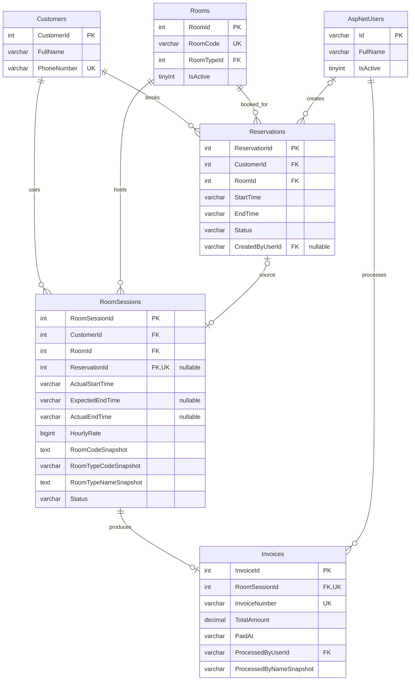

# ERD nhóm khách hàng, booking, phiên và hóa đơn

Ngày 20/10/2026. Bản theo nhóm phục vụ báo cáo và bước UI lịch sử khách 8f.2. Đối chiếu mục 21/35–37 của `Reference_Web_ProjectPlan_v1.3.md`, `Data/MySqlSchema.sql` (MySQL v1), `RoomUsageSchema.cs` và `InvoiceSchema.cs` (ứng dụng SQLite v8).

Đây là sơ đồ rút gọn từ DDL trong repository, chưa phải kết quả introspection cloud. Chỉ liệt kê cột liên quan đến liên kết/lịch sử; không thay thế ERD tổng thể, từ điển toàn bộ cột hoặc bản xuất hình cho báo cáo. App vẫn dùng SQLite; service lịch sử MySQL và UI lịch sử chưa triển khai.

PK là khóa chính, FK là khóa ngoại, UK là khóa duy nhất. Kiểu trên sơ đồ theo MySQL; bảng Rooms còn FK đến RoomTypes ngoài nhóm đang vẽ. Một Customer/Room có thể chưa có hoặc có nhiều booking/phiên. Một booking có tối đa một phiên; một phiên có thể không có booking nguồn (walk-in). Một phiên có tối đa một hóa đơn ở mức DDL.

## Từ điển liên kết và dữ liệu lịch sử

| Trường/nhóm | Kiểu MySQL, null và ràng buộc | Ý nghĩa |
| --- | --- | --- |
| Customers.CustomerId | INT, PK, AUTO_INCREMENT | Khóa nối lịch sử, giữ nguyên khi sửa tên/SĐT. |
| Customers.PhoneNumber | VARCHAR(10), NOT NULL, UNIQUE, CHECK `^0[0-9]{9}$` | Số hiện hành sau chuẩn hóa; không dùng làm khóa nối lịch sử. |
| Reservations.CustomerId / RoomId | INT, NOT NULL, FK | Khách và phòng của booking. |
| Reservations.StartTime / EndTime | VARCHAR(33), NOT NULL, CHECK định dạng UTC và Start < End | Giờ đặt ban đầu; không thay bằng giờ thực tế của phiên. |
| Reservations.Status | VARCHAR(20), NOT NULL, CHECK | Confirmed, CheckedIn, Completed, Cancelled, NoShow. Lịch sử trả trạng thái lưu, không chạy NoShow. |
| Reservations.CreatedByUserId | VARCHAR(128), NULL, FK | Người đặt hộ; Guest không có user nhân viên. |
| RoomSessions.CustomerId / RoomId | INT, NOT NULL, FK | Nối trực tiếp khách/phòng, kể cả walk-in. |
| RoomSessions.ReservationId | INT, NULL, UNIQUE, FK | Tối đa một phiên cho mỗi booking; nhiều walk-in có thể cùng NULL. |
| RoomSessions.ActualStartTime | VARCHAR(33), NOT NULL | Giờ nhận thực tế, giữ độ chính xác tick. |
| RoomSessions.ExpectedEndTime | VARCHAR(33), NULL, CHECK > ActualStartTime nếu có | Booking nguồn bắt buộc có giờ dự kiến; walk-in do service tạo với NULL. |
| RoomSessions.ActualEndTime / Status | VARCHAR(33) NULL / VARCHAR(20) NOT NULL | Active có ActualEndTime NULL; Completed có ActualEndTime và không trước ActualStartTime. |
| RoomSessions.HourlyRate / các cột Snapshot | BIGINT dương / TEXT hoặc VARCHAR, NOT NULL | Giá giờ, mã phòng và loại phòng tại lúc nhận; không lấy lại giá/loại hiện tại để sửa lịch sử. |
| Invoices.RoomSessionId | INT, NOT NULL, UNIQUE, FK | Hóa đơn thuộc phiên, không có CustomerId riêng. Tìm khách qua RoomSessions. |
| Invoices.InvoiceNumber | VARCHAR(50), NOT NULL, UNIQUE, không trắng | Số hóa đơn hiển thị. |
| Invoices.RoomCharge / ServiceCharge / TotalAmount | DECIMAL(29,0), NOT NULL, CHECK 0..79228162514264337593543950335 | Tiền nguyên đồng; lịch sử đọc số đã chốt trên hóa đơn. |
| Invoices.PaidAt / PaymentMethod | VARCHAR(33) NOT NULL / VARCHAR(20) NOT NULL | Giờ thu tiền UTC; Cash hoặc BankTransfer. |
| Invoices.ProcessedByUserId / ProcessedByNameSnapshot | VARCHAR(128) FK / VARCHAR(100), NOT NULL | Liên kết người thu và tên tại lúc thu; đổi tên user không sửa snapshot. |

Các trường trên không có DEFAULT tường minh trong DDL MySQL; ID dùng AUTO_INCREMENT. SQLite dùng INTEGER/TEXT tương ứng; riêng các khoản tiền hóa đơn là TEXT thập phân nguyên chuẩn để tránh mất chính xác, không phải REAL. Thời gian nghiệp vụ chuẩn lưu UTC round-trip với 7 chữ số phần giây; giao diện chuyển UTC+7.

## Ràng buộc database và quy tắc service

- SQLite có unique index theo điều kiện Status='Active' trên RoomId và CustomerId. MySQL dùng hai cột generated ActiveRoomId/ActiveCustomerId và UNIQUE, trả NULL cho phiên Completed. Vì vậy vẫn giữ được nhiều phiên lịch sử của cùng phòng/khách.
- FK riêng lẻ không chứng minh CustomerId/RoomId của phiên trùng booking nguồn. Service kiểm tra điều này trong transaction; overlap lịch cũng cần kiểm tra nghiệp vụ, không được thay bằng unique(RoomId, StartTime).
- UNIQUE Invoices.RoomSessionId chỉ bảo đảm tối đa một hóa đơn. Quy tắc phiên Completed có đúng một hóa đơn được bảo đảm bởi transaction checkout, không phải FK tự tạo hóa đơn.
- Không xóa khách/danh mục có lịch sử. Khóa phòng hoặc tài khoản không loại lịch sử. Không cập nhật snapshot theo danh mục hiện tại.

## Cách đọc lịch sử khách

`CustomerHistoryService.Read` lấy booking và phiên theo CustomerId; hóa đơn JOIN qua RoomSessions.CustomerId. Đổi SĐT rồi cấp số cũ cho khách khác không chuyển dữ liệu lịch sử.

Số lần hoàn tất chỉ đếm RoomSessions Completed, gồm booking và walk-in. Lần dùng gần nhất là ActualStartTime mới nhất của phiên Active/Completed; khách chưa sử dụng nhận 0/null. Không đếm booking tương lai, hủy hoặc NoShow thành lượt sử dụng.

Customer.View hiện hành bắt buộc; Invoice.View kiểm tra riêng trong cùng read snapshot. Thiếu Invoice.View phải hiển thị thiếu quyền thay vì kết luận khách chưa có hóa đơn. Đây là dữ liệu nội bộ, không đưa lịch sử hoặc hóa đơn vào đường Guest tra cứu SĐT.

## Kiểm tra và phần còn lại

Đã đối chiếu thủ công tên bảng/cột, FK, null, unique và CHECK với ba nguồn DDL ở đầu tài liệu; đối chiếu đường JOIN/cách đếm với `CustomerHistoryService.cs`. Không chạy migration hoặc truy cập database thật. Thay đổi chỉ là tài liệu nên không yêu cầu build lại ứng dụng.

Còn ERD tổng thể MySQL, các nhóm RBAC/món, từ điển đầy đủ và bản xuất hình; UI lịch sử 8f.2 và migration vẫn giữ scope. Khối Mermaid là nguồn chỉnh sửa được trong repo.
