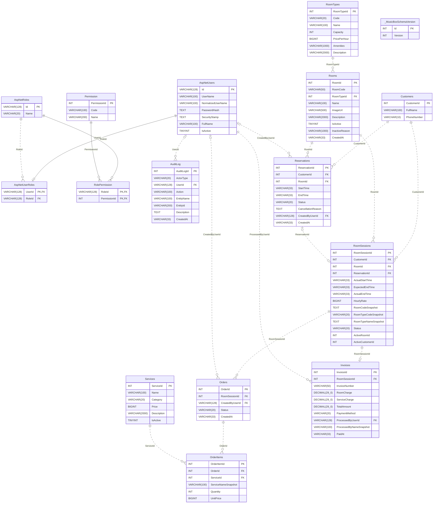

# Từ điển dữ liệu và ERD tổng thể

Nguồn: MySqlSchema.sql v1 và MySqlDatabase.cs (_MusicBoxSchemaVersion), tương ứng SQLite v8. Không introspect hoặc chứa dữ liệu thật. Chạy lại `python Tools/Export-SchemaDocs.py` khi DDL đổi.

Có 15 bảng nghiệp vụ + bảng phiên bản. PK/FK/unique/check trong DDL là nguồn chuẩn; sơ đồ không thay các luật transaction trong service.

## Quy ước

- Timestamp nghiệp vụ lưu UTC round-trip O, 7 chữ số phần giây; importer chuẩn hóa offset/Z và giữ ticks. AuditLog.CreatedAt là VARCHAR(33), writer/importer chuẩn hóa; không suy rằng riêng cột này có CHECK regex trong DDL.
- RoomSession/OrderItem/Invoice giữ snapshot lịch sử; chỉnh danh mục không sửa snapshot.
- Giá đơn vị là BIGINT; tổng Invoice là DECIMAL(29,0), trong phạm vi .NET decimal. SQLite lưu tổng tiền dạng TEXT.
- ActiveRoomId/ActiveCustomerId là cột generated MySQL để unique khi Active; SQLite dùng partial unique index. Không nhập trực tiếp hai cột generated.
- User có đúng một role theo PK MySQL AspNetUserRoles.UserId và service; Staff/Manager dùng RolePermission, Admin toàn quyền cố định từ code.
- Reservation → RoomSession và RoomSession → Invoice có unique; trạng thái Completed có Invoice là luật service/transaction, FK không tự tạo hóa đơn.
- FK Nullable giữ Guest/System audit không user, walk-in không reservation, ExpectedEnd null cho walk-in.

## Các bảng

### RoomTypes

| Cột | Kiểu MySQL | Ràng buộc/ghi chú từ DDL |
|---|---|---|
| RoomTypeId | INT | PRIMARY KEY AUTO_INCREMENT |
| Code | VARCHAR(20) | NOT NULL UNIQUE CHECK(Code IN ('STANDARD','VIP')) |
| Name | VARCHAR(100) | NOT NULL CHECK(CHAR_LENGTH(TRIM(Name)) BETWEEN 1 AND 100) |
| Capacity | INT | NOT NULL CHECK(Capacity>0) |
| PricePerHour | BIGINT | NOT NULL CHECK(PricePerHour>0) |
| Amenities | VARCHAR(1000) | NOT NULL CHECK(CHAR_LENGTH(TRIM(Amenities)) BETWEEN 1 AND 1000) |
| Description | VARCHAR(2000) | NULL |

### AspNetUsers

| Cột | Kiểu MySQL | Ràng buộc/ghi chú từ DDL |
|---|---|---|
| Id | VARCHAR(128) | PRIMARY KEY |
| UserName | VARCHAR(100) | NOT NULL CHECK(CHAR_LENGTH(TRIM(UserName)) BETWEEN 1 AND 100) |
| NormalizedUserName | VARCHAR(100) | NOT NULL UNIQUE |
| PasswordHash | TEXT | NOT NULL CHECK(CHAR_LENGTH(PasswordHash)>0) |
| SecurityStamp | TEXT | NOT NULL CHECK(CHAR_LENGTH(SecurityStamp)>0) |
| FullName | VARCHAR(100) | NOT NULL CHECK(CHAR_LENGTH(TRIM(FullName)) BETWEEN 1 AND 100) |
| IsActive | TINYINT | NOT NULL CHECK(IsActive IN (0,1)) |

### AspNetRoles

| Cột | Kiểu MySQL | Ràng buộc/ghi chú từ DDL |
|---|---|---|
| Id | VARCHAR(128) | PRIMARY KEY |
| Name | VARCHAR(20) | NOT NULL UNIQUE CHECK(Name IN ('Staff','Manager','Admin')) |

### AspNetUserRoles

| Cột | Kiểu MySQL | Ràng buộc/ghi chú từ DDL |
|---|---|---|
| UserId | VARCHAR(128) | PRIMARY KEY |
| RoleId | VARCHAR(128) | NOT NULL |

Ràng buộc cấp bảng:
- `FOREIGN KEY(UserId) REFERENCES AspNetUsers(Id)`
- `FOREIGN KEY(RoleId) REFERENCES AspNetRoles(Id)`
- `INDEX IX_AspNetUserRoles_RoleId(RoleId)`

### Permission

| Cột | Kiểu MySQL | Ràng buộc/ghi chú từ DDL |
|---|---|---|
| PermissionId | INT | PRIMARY KEY AUTO_INCREMENT |
| Code | VARCHAR(100) | NOT NULL UNIQUE |
| Name | VARCHAR(200) | NOT NULL |

### RolePermission

| Cột | Kiểu MySQL | Ràng buộc/ghi chú từ DDL |
|---|---|---|
| RoleId | VARCHAR(128) | NOT NULL |
| PermissionId | INT | NOT NULL |

Ràng buộc cấp bảng:
- `PRIMARY KEY(RoleId,PermissionId)`
- `FOREIGN KEY(RoleId) REFERENCES AspNetRoles(Id)`
- `FOREIGN KEY(PermissionId) REFERENCES Permission(PermissionId)`

### AuditLog

| Cột | Kiểu MySQL | Ràng buộc/ghi chú từ DDL |
|---|---|---|
| AuditLogId | INT | PRIMARY KEY AUTO_INCREMENT |
| ActorType | VARCHAR(20) | NOT NULL CHECK(ActorType IN ('Staff','Guest','System')) |
| UserId | VARCHAR(128) | NULL |
| Action | VARCHAR(100) | NOT NULL |
| EntityName | VARCHAR(100) | NOT NULL |
| EntityId | VARCHAR(200) | NULL |
| Description | TEXT | NOT NULL |
| CreatedAt | VARCHAR(33) | NOT NULL |

Ràng buộc cấp bảng:
- `FOREIGN KEY(UserId) REFERENCES AspNetUsers(Id)`

### Rooms

| Cột | Kiểu MySQL | Ràng buộc/ghi chú từ DDL |
|---|---|---|
| RoomId | INT | PRIMARY KEY AUTO_INCREMENT |
| RoomCode | VARCHAR(50) | COLLATE utf8mb4_0900_as_ci NOT NULL UNIQUE CHECK(CHAR_LENGTH(TRIM(RoomCode)) BETWEEN 1 AND 50) |
| RoomTypeId | INT | NOT NULL |
| Name | VARCHAR(100) | NOT NULL CHECK(CHAR_LENGTH(TRIM(Name)) BETWEEN 1 AND 100) |
| ImageUrl | VARCHAR(500) | NOT NULL CHECK(CHAR_LENGTH(TRIM(ImageUrl)) BETWEEN 1 AND 500) |
| Description | VARCHAR(2000) | NULL |
| IsActive | TINYINT | NOT NULL CHECK(IsActive IN (0,1)) |
| InactiveReason | VARCHAR(1000) | NULL |
| CreatedAt | VARCHAR(33) | NOT NULL |

Ràng buộc cấp bảng:
- `FOREIGN KEY(RoomTypeId) REFERENCES RoomTypes(RoomTypeId)`

### Customers

| Cột | Kiểu MySQL | Ràng buộc/ghi chú từ DDL |
|---|---|---|
| CustomerId | INT | PRIMARY KEY AUTO_INCREMENT |
| FullName | VARCHAR(100) | NOT NULL CHECK(CHAR_LENGTH(TRIM(FullName)) BETWEEN 1 AND 100) |
| PhoneNumber | VARCHAR(10) | NOT NULL UNIQUE CHECK(REGEXP_LIKE(PhoneNumber,'^0[0-9]{9}$','c')) |

### Reservations

| Cột | Kiểu MySQL | Ràng buộc/ghi chú từ DDL |
|---|---|---|
| ReservationId | INT | PRIMARY KEY AUTO_INCREMENT |
| CustomerId | INT | NOT NULL |
| RoomId | INT | NOT NULL |
| StartTime | VARCHAR(33) | NOT NULL CHECK(REGEXP_LIKE(StartTime,'^[0-9]{4}-(0[1-9]&#124;1[0-2])-(0[1-9]&#124;[12][0-9]&#124;3[01])T([01][0-9]&#124;2[0-3]):[0-5][0-9]:[0-5][0-9][.][0-9]{7}[+]00:00$','c')) |
| EndTime | VARCHAR(33) | NOT NULL CHECK(REGEXP_LIKE(EndTime,'^[0-9]{4}-(0[1-9]&#124;1[0-2])-(0[1-9]&#124;[12][0-9]&#124;3[01])T([01][0-9]&#124;2[0-3]):[0-5][0-9]:[0-5][0-9][.][0-9]{7}[+]00:00$','c')) |
| Status | VARCHAR(20) | NOT NULL CHECK(Status IN ('Confirmed','CheckedIn','Completed','Cancelled','NoShow')) |
| CancellationReason | TEXT | NULL |
| CreatedByUserId | VARCHAR(128) | NULL |
| CreatedAt | VARCHAR(33) | NOT NULL |

Ràng buộc cấp bảng:
- `FOREIGN KEY(CustomerId) REFERENCES Customers(CustomerId)`
- `FOREIGN KEY(RoomId) REFERENCES Rooms(RoomId)`
- `FOREIGN KEY(CreatedByUserId) REFERENCES AspNetUsers(Id)`
- `INDEX Reservations_Room_Status_Start(RoomId,Status,StartTime)`
- `INDEX Reservations_Customer_Status_Start(CustomerId,Status,StartTime)`

### RoomSessions

| Cột | Kiểu MySQL | Ràng buộc/ghi chú từ DDL |
|---|---|---|
| RoomSessionId | INT | PRIMARY KEY AUTO_INCREMENT |
| CustomerId | INT | NOT NULL |
| RoomId | INT | NOT NULL |
| ReservationId | INT | NULL UNIQUE |
| ActualStartTime | VARCHAR(33) | NOT NULL CHECK(REGEXP_LIKE(ActualStartTime,'^[0-9]{4}-(0[1-9]&#124;1[0-2])-(0[1-9]&#124;[12][0-9]&#124;3[01])T([01][0-9]&#124;2[0-3]):[0-5][0-9]:[0-5][0-9][.][0-9]{7}[+]00:00$','c')) |
| ExpectedEndTime | VARCHAR(33) | NULL CHECK(ExpectedEndTime IS NULL OR REGEXP_LIKE(ExpectedEndTime,'^[0-9]{4}-(0[1-9]&#124;1[0-2])-(0[1-9]&#124;[12][0-9]&#124;3[01])T([01][0-9]&#124;2[0-3]):[0-5][0-9]:[0-5][0-9][.][0-9]{7}[+]00:00$','c')) |
| ActualEndTime | VARCHAR(33) | NULL CHECK(ActualEndTime IS NULL OR REGEXP_LIKE(ActualEndTime,'^[0-9]{4}-(0[1-9]&#124;1[0-2])-(0[1-9]&#124;[12][0-9]&#124;3[01])T([01][0-9]&#124;2[0-3]):[0-5][0-9]:[0-5][0-9][.][0-9]{7}[+]00:00$','c')) |
| HourlyRate | BIGINT | NOT NULL CHECK(HourlyRate>0) |
| RoomCodeSnapshot | TEXT | NOT NULL CHECK(CHAR_LENGTH(TRIM(RoomCodeSnapshot))>0) |
| RoomTypeCodeSnapshot | VARCHAR(20) | NOT NULL CHECK(RoomTypeCodeSnapshot IN ('STANDARD','VIP')) |
| RoomTypeNameSnapshot | TEXT | NOT NULL CHECK(CHAR_LENGTH(TRIM(RoomTypeNameSnapshot))>0) |
| Status | VARCHAR(20) | NOT NULL CHECK(Status IN ('Active','Completed')) |
| ActiveRoomId | INT | GENERATED ALWAYS AS (CASE WHEN Status='Active' THEN RoomId ELSE NULL END) STORED |
| ActiveCustomerId | INT | GENERATED ALWAYS AS (CASE WHEN Status='Active' THEN CustomerId ELSE NULL END) STORED |

Ràng buộc cấp bảng:
- `UNIQUE RoomSessions_ActiveRoom(ActiveRoomId)`
- `UNIQUE RoomSessions_ActiveCustomer(ActiveCustomerId)`
- `FOREIGN KEY(CustomerId) REFERENCES Customers(CustomerId)`
- `FOREIGN KEY(RoomId) REFERENCES Rooms(RoomId)`
- `FOREIGN KEY(ReservationId) REFERENCES Reservations(ReservationId)`

### Services

| Cột | Kiểu MySQL | Ràng buộc/ghi chú từ DDL |
|---|---|---|
| ServiceId | INT | PRIMARY KEY AUTO_INCREMENT |
| Name | VARCHAR(100) | NOT NULL CHECK(CHAR_LENGTH(TRIM(Name)) BETWEEN 1 AND 100) |
| Category | VARCHAR(20) | NOT NULL CHECK(Category IN ('Đồ uống','Đồ ăn','Khác')) |
| Price | BIGINT | NOT NULL CHECK(Price>0) |
| Description | VARCHAR(2000) | NULL |
| IsActive | TINYINT | NOT NULL CHECK(IsActive IN (0,1)) |

### Orders

| Cột | Kiểu MySQL | Ràng buộc/ghi chú từ DDL |
|---|---|---|
| OrderId | INT | PRIMARY KEY AUTO_INCREMENT |
| RoomSessionId | INT | NOT NULL |
| CreatedByUserId | VARCHAR(128) | NULL |
| Status | VARCHAR(20) | NOT NULL CHECK(Status IN ('Pending','Completed','Cancelled')) |
| CreatedAt | VARCHAR(33) | NOT NULL CHECK(REGEXP_LIKE(CreatedAt,'^[0-9]{4}-(0[1-9]&#124;1[0-2])-(0[1-9]&#124;[12][0-9]&#124;3[01])T([01][0-9]&#124;2[0-3]):[0-5][0-9]:[0-5][0-9][.][0-9]{7}[+]00:00$','c')) |

Ràng buộc cấp bảng:
- `FOREIGN KEY(RoomSessionId) REFERENCES RoomSessions(RoomSessionId)`
- `FOREIGN KEY(CreatedByUserId) REFERENCES AspNetUsers(Id)`
- `INDEX IX_Orders_Session(RoomSessionId,OrderId)`

### OrderItems

| Cột | Kiểu MySQL | Ràng buộc/ghi chú từ DDL |
|---|---|---|
| OrderItemId | INT | PRIMARY KEY AUTO_INCREMENT |
| OrderId | INT | NOT NULL |
| ServiceId | INT | NOT NULL |
| ServiceNameSnapshot | VARCHAR(100) | NOT NULL CHECK(CHAR_LENGTH(TRIM(ServiceNameSnapshot)) BETWEEN 1 AND 100) |
| Quantity | INT | NOT NULL CHECK(Quantity BETWEEN 1 AND 10) |
| UnitPrice | BIGINT | NOT NULL CHECK(UnitPrice>0) |

Ràng buộc cấp bảng:
- `FOREIGN KEY(OrderId) REFERENCES Orders(OrderId)`
- `FOREIGN KEY(ServiceId) REFERENCES Services(ServiceId)`

### Invoices

| Cột | Kiểu MySQL | Ràng buộc/ghi chú từ DDL |
|---|---|---|
| InvoiceId | INT | PRIMARY KEY AUTO_INCREMENT |
| RoomSessionId | INT | NOT NULL UNIQUE |
| InvoiceNumber | VARCHAR(50) | NOT NULL UNIQUE CHECK(CHAR_LENGTH(TRIM(InvoiceNumber)) BETWEEN 1 AND 50) |
| RoomCharge | DECIMAL(29,0) | NOT NULL CHECK(RoomCharge BETWEEN 0 AND 79228162514264337593543950335) |
| ServiceCharge | DECIMAL(29,0) | NOT NULL CHECK(ServiceCharge BETWEEN 0 AND 79228162514264337593543950335) |
| TotalAmount | DECIMAL(29,0) | NOT NULL CHECK(TotalAmount BETWEEN 0 AND 79228162514264337593543950335) |
| PaymentMethod | VARCHAR(20) | NOT NULL CHECK(PaymentMethod IN ('Cash','BankTransfer')) |
| ProcessedByUserId | VARCHAR(128) | NOT NULL |
| ProcessedByNameSnapshot | VARCHAR(100) | NOT NULL CHECK(CHAR_LENGTH(TRIM(ProcessedByNameSnapshot)) BETWEEN 1 AND 100) |
| PaidAt | VARCHAR(33) | NOT NULL CHECK(REGEXP_LIKE(PaidAt,'^[0-9]{4}-(0[1-9]&#124;1[0-2])-(0[1-9]&#124;[12][0-9]&#124;3[01])T([01][0-9]&#124;2[0-3]):[0-5][0-9]:[0-5][0-9][.][0-9]{7}[+]00:00$','c')) |

Ràng buộc cấp bảng:
- `FOREIGN KEY(RoomSessionId) REFERENCES RoomSessions(RoomSessionId)`
- `FOREIGN KEY(ProcessedByUserId) REFERENCES AspNetUsers(Id)`
- `INDEX IX_Invoices_PaidAt(PaidAt)`

### _MusicBoxSchemaVersion

| Cột | Kiểu MySQL | Ràng buộc/ghi chú từ DDL |
|---|---|---|
| Id | INT | PRIMARY KEY CHECK(Id=1) |
| Version | INT | NOT NULL CHECK(Version>=0) |

## Sơ đồ

Nguồn [Mermaid](schema/MusicBox_Full.mmd), [Graphviz DOT](schema/MusicBox_Full.dot), bản xuất [SVG](schema/MusicBox_Full.svg) và [PNG](schema/MusicBox_Full.png). Quy ước ký hiệu theo [Mermaid ER syntax](https://mermaid.js.org/syntax/entityRelationshipDiagram.html).

