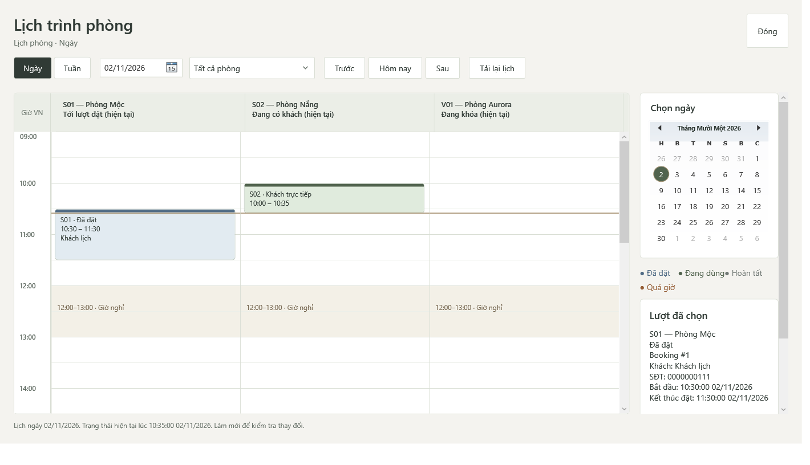
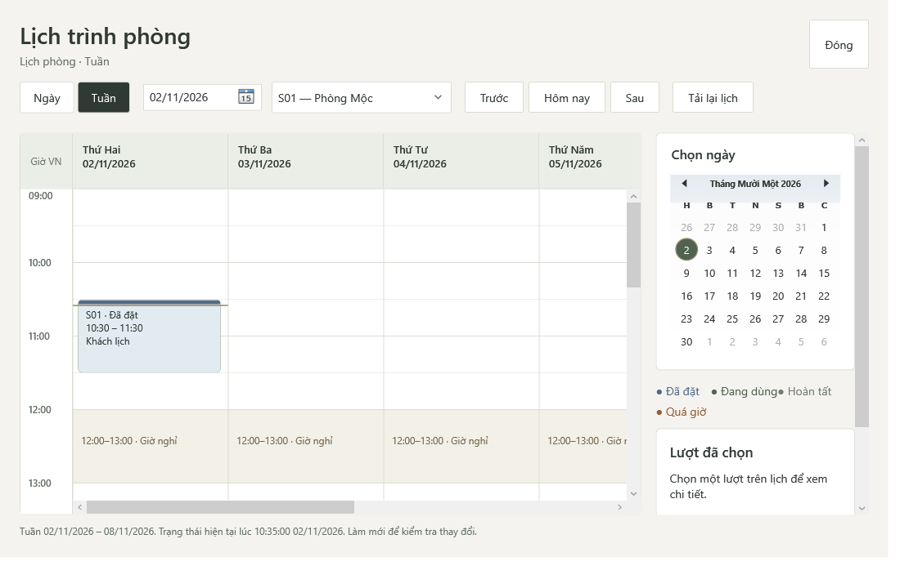
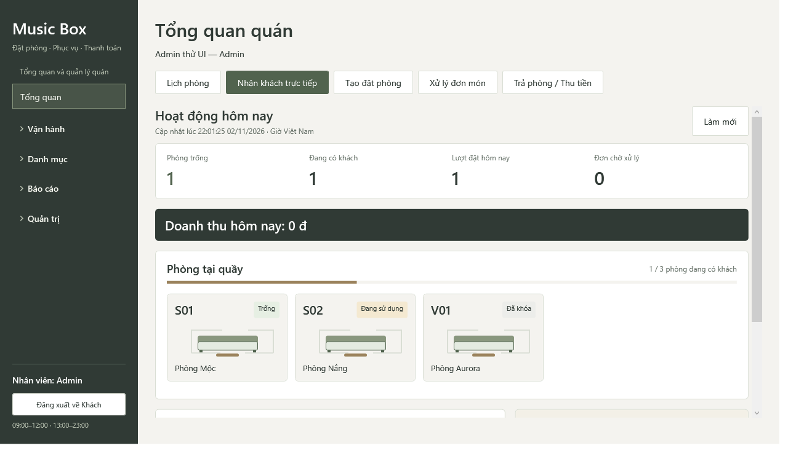

# Lịch phòng, dashboard và menu đặt phòng — 02/11/2026

## Kết quả sử dụng

- **Lịch phòng:** mặc định Ngày / tất cả phòng. Cột là phòng, giờ chạy dọc 09:00–23:00, tô khoảng nghỉ 12:00–13:00. Header phòng và trục giờ giữ vị trí khi cuộn; chọn khối lịch để xem chi tiết bên phải. Có lịch tháng, lọc phòng, Trước / Hôm nay / Sau. Chuyển Tuần ban đầu chọn một phòng; vẫn có thể chọn tất cả phòng nếu cần.
- **Dashboard:** bốn chỉ số, doanh thu theo quyền, bảng phòng bằng vector WPF 2D, nhãn trạng thái, thanh số phòng đang có khách, lịch hôm nay / phiên / đơn món và cảnh báo. Thanh phòng là số phòng đang dùng trên tổng số phòng, không phải báo cáo công suất theo thời gian. Giữ Segoe UI và palette Music Box; không cài thêm thư viện.
- **Đặt phòng:** chỉ một mục trong Vận hành. Có Reservation.View thì mở danh sách và tạo theo quyền; chỉ có Reservation.Create thì mở thẳng form đặt hộ. Nút nhanh “Tạo đặt phòng” cần Create. Có thêm nút nhanh “Lịch phòng”. Nhận khách trực tiếp vẫn riêng vì walk-in khác giữ chỗ trước.

Khách vẫn đặt/tra cứu như cũ. Không đổi service nghiệp vụ, truy vấn MySQL, schema, tiền, trạng thái, SSL hoặc dữ liệu quán. Khối lịch giữ giờ thực tế, phần dự kiến viền đứt, các làn chồng nhau và cảnh báo quá giờ. Đường ngang brass dùng thời điểm snapshot; không có timer hoặc truy vấn khi resize/scroll. Làm mới để đọc trạng thái mới.

## Cách thử

1. Build và mở ứng dụng; đăng nhập nhân viên đủ quyền. Tổng quan hiển thị bảng phòng mới.
2. Bấm **Lịch phòng**. Kiểm tra Ngày / tất cả phòng, chọn ngày trên lịch tháng, lọc phòng và chuyển Tuần.
3. Cuộn dọc/ngang; tên cột và giờ vẫn bám lịch. Chọn một lượt để xem khách, giờ và trạng thái.
4. Trong Vận hành chỉ còn **Đặt phòng**. Tạo đặt phòng từ nút nhanh hoặc danh sách. Khách đến ngay không đặt trước dùng **Nhận khách trực tiếp**.
5. Thu nhỏ cửa sổ: các nút nhanh xuống dòng, dashboard cuộn được, lịch tuần có cuộn ngang khi thiếu chiều rộng.

## Kiểm chứng và giới hạn

Runner mới: `Tests/Verify-MySqlCounterUi.ps1`, chạy PowerShell Desktop ở STA. Chỉ khởi tạo MySQL services; không chạy Verify-All hoặc runner pha provider. Mỗi lượt tạo `musicbox_test_<GUID>` riêng và dọn đúng database đó trong finally. Tài khoản là SetupAdmin/Login thật; booking và walk-in được tạo qua service thật. SQL fixture chỉ dựng danh mục/quyền/tài khoản vô hiệu hóa để thử; không tác động database `musicbox`.

Các assertion: Ngày/tất cả phòng; chọn khối xem chi tiết; lịch tháng đổi sang tuần khác và đối chiếu chính xác Range.Start; chọn phòng thật; mỗi thao tác Today/mode/month/room đúng một lần Read; resize/scroll không Read; quyền Create-only và View-only mở đúng form; View-only không được tạo; Staff không nhận doanh thu tổng hợp; revoke xóa phòng/chi tiết cũ; trạng thái busy của nút nhanh.

Ảnh thường/compact, Ngày/Tuần, cuộn, Admin/Staff và bị thu hồi quyền được render bằng WPF RenderTargetBitmap. Đã xem trực tiếp ảnh, sửa màu chữ chế độ đang chọn, kích thước ngày trong lịch tháng, vùng tô khối lịch và binding ProgressBar OneWay. Đây là kiểm tra UI và luồng chọn mở form trên MySQL; không phải nghiệm thu mọi tổ hợp nghiệp vụ, màn hình/DPI/máy in thật hoặc toàn bộ bộ test của project.

### Nhật ký lượt chạy

- RED hợp lệ: `MusicBoxCounterUiRed_20261102.log`, exit 1 vì chưa có MonthCalendar, trước khi tạo database. Hai lỗi biên dịch fixture trước đó (tên helper Main và SystemClock internal) đã sửa trong test.
- Build đầu đạt. UI GreenDebug đầu đi qua lịch rồi thất bại tại dashboard: ProgressBar.Value mặc định TwoWay trên property chỉ đọc. Đã sửa Mode=OneWay, giữ log `MusicBoxCounterUiGreenDebug_20261102.log`.
- RetryDebug đạt; FinalDebug đạt; FinalDebug2 đạt với đếm Read và kiểm tuần chính xác. FinalRelease đạt thêm chọn phòng và số phòng không rỗng.
- Bản dùng thật và kết quả cuối: xem phần xác nhận cuối bên dưới. Log nằm trong TEMP của máy chạy, ảnh minh họa chọn lọc được lưu cùng tài liệu này.

Review cuối độc lập chỉ đọc: không có Critical/Important xác nhận. Một Minor về nút nhanh chưa phản ánh busy đã sửa binding về StaffBookingButton và thêm assertion. Quan ngại thứ tự event/binding chọn ngày được kiểm bằng đổi sang tuần khác + chọn phòng + đếm truy vấn. Phần backend không đổi, production data, driver/máy in và diff csproj có sẵn nằm ngoài lượt review.

## Ảnh fixture

Dữ liệu trong ảnh chỉ phục vụ kiểm tra, không phải phòng/khách/doanh thu tại quán.

## Xác nhận cuối

- Build dùng thật `bin/Debug` và `bin/Release`: exit 0. Chạy runner UI cuối trên cả hai build: exit 0; mỗi bản có 8 ảnh. Final Debug fixture `musicbox_test_6c995cf341c940e3acd4c1211c0f09e5`, Release fixture `musicbox_test_4a023054c0c24b5295e278cce93cd1c6` đã được finally dọn.
- Bản log lưu trong Git chỉ bỏ khoảng trắng cuối dòng; log gốc vẫn ở TEMP.
- [Log Debug](verification/20261102-counter-ui/debug-ui.log), [Release](verification/20261102-counter-ui/release-ui.log), [build Debug](verification/20261102-counter-ui/debug-build.log), [build Release](verification/20261102-counter-ui/release-build.log), [RED](verification/20261102-counter-ui/red.log), [lỗi binding lượt đầu](verification/20261102-counter-ui/first-green-failure.log).
- Đã xem ảnh Release thường/compact, ngày/tuần, Admin/Staff và sau revoke; không còn nội dung khách sau khi quyền bị thu hồi. Snapshot lịch dùng clock fixture 10:35, dashboard đọc clock hiện hành của fixture, nên trạng thái booking trong hai ảnh có thể khác theo giờ.
- Không sửa/cấp lại quyền production; không cắt chức năng. Diff csproj có sẵn 171/49 giữ nguyên ngoài commit. Chưa nghiệm thu trực tiếp trên màn hình/DPI khác hoặc máy in tại quầy.
