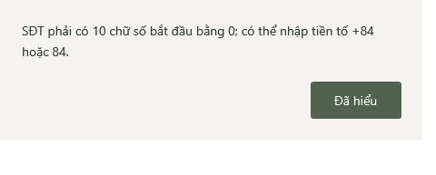
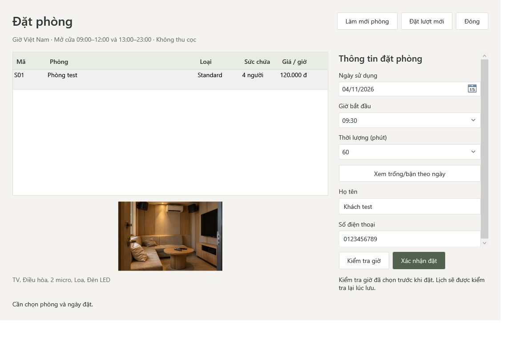

# Thông báo thao tác và kiểm tra nhập liệu — 04/11/2026

## Vấn đề và kết quả

Người dùng nhập SĐT 9 số khi đặt phòng, Visual Studio dừng tại `throw` trong PhoneNumberNormalizer và giao diện chưa có popup. Trước đây VM đã có catch và Status cuối form, nhưng việc chỉ nhìn thấy exception trong debugger khiến thao tác có cảm giác bị thoát. Lượt này sửa cả phản hồi giao diện và kiểm tra định dạng trước khi gọi service.

- Một hộp thông báo WPF dùng chung, có owner và nút **Đã hiểu**. Đặt/tra cứu/lưu/xác nhận/hủy/gia hạn/thao tác giỏ và các lệnh dữ liệu được gọi qua command boundary rõ ràng; Status trên form vẫn giữ. Form nhập sai không đóng, không xóa tên/SĐT. Không popup mỗi lần gõ, chọn dòng hoặc tải tự động ban đầu.
- `PhoneNumberNormalizer.TryNormalize` dùng cùng quy tắc với Normalize: 10 số bắt đầu 0 sau chuẩn hóa; nhận +84/84, bỏ khoảng trắng/chấm/gạch ngang. Normalize vẫn bảo vệ service trực tiếp bằng exception như trước. Preflight ở đặt phòng, tra cứu, walk-in, khách hàng và bộ lọc SĐT của booking/phiên/hóa đơn.
- Ngày/giờ/thời lượng còn thiếu trong form đặt phòng và ngày còn thiếu trong lịch/báo cáo được trả về Status mà không tự ném exception từ VM. Validation/quyền/transaction của service vẫn kiểm tra lại.
- Command boundary bắt lỗi ngoài dự kiến để báo an toàn, không hiển thị chi tiết kết nối, giữ cửa sổ mở; log Trace chỉ loại exception. Không có global handler nuốt mọi lỗi.
- Chặn lặp cùng lệnh trên cùng cửa sổ khi đang chạy hoặc popup chưa đóng. Popup lưu thành công lấy Status trước khi chọn lại dòng; bỏ món và yêu cầu hủy/phục vụ cập nhật thông điệp riêng.

Không đổi schema, query, giá/tiền, trạng thái/quyền hay dữ liệu `musicbox`; không sửa hoặc chạy backend/test cũ bị người dùng cấm. Csproj chỉ thêm Compile cho UserFeedback.cs, giữ định dạng có sẵn ngoài commit.

## Phạm vi rà source

| Nhóm | Điểm hiển thị thông báo |
|---|---|
| Đặt phòng Khách / đặt hộ | Làm mới, Kiểm tra giờ, Xác nhận đặt; báo lỗi nếu không mở được lịch |
| Tra cứu Khách | Tra cứu, yêu cầu/xác nhận hủy, xem trước/xác nhận gia hạn, giữ booking/giờ trả |
| Gọi món Khách / món nhân viên | Tải lại, thêm/bỏ món, xem trước, gửi, yêu cầu hủy/phục vụ, xác nhận, quay lại |
| Khách hàng / dịch vụ | Tìm/làm mới/lưu; bảo toàn thông điệp commit thành công dù reload lỗi |
| Phòng / loại phòng | Làm mới, thêm/sửa/lưu; giữ kết quả đóng editor chỉ khi lưu thành công |
| Booking / walk-in / phiên | Tìm, nhận/xác nhận, hủy/xác nhận, gia hạn/xác nhận |
| Thanh toán / tiền tạm tính | Tải/tính tiền/xác nhận; điều kiện đã nhận tiền vẫn bắt buộc |
| Đăng nhập / tài khoản / RBAC | Trường bắt buộc, mật khẩu không khớp, kết quả đăng nhập, chuẩn bị/lưu quyền và tài khoản |
| Báo cáo / Excel / hóa đơn / audit / lịch sử | Tìm, tải, xuất Excel, lỗi không chuẩn bị được bản in; thao tác in thực tế giữ luồng hiện hành |
| Tổng quan / lịch | Làm mới theo lệnh người dùng; các lựa chọn lịch/ngày và tải tự động giữ phản hồi tại form |

Các handler mở màn ở MainWindow đã có thông báo lỗi và guard phiên/quyền từ trước. Không viết lại nghiệp vụ/backend chỉ để tránh debugger dừng. Chọn ảnh/chọn dòng/đổi bộ lọc vẫn là chỉnh dữ liệu trên form, không tạo popup vô ích.

## Kiểm chứng

`Tests/Verify-MySqlFeedbackUi.ps1` và `Tests/MySqlFeedbackUiChecks.cs` chỉ dùng MySQL services + WPF, không runner pha provider. Có `-PreflightOnly` để thử popup/normalizer/command boundary mà không mở database.

Bài đầu bấm Tra cứu với 9 số trên service gắn một tên database chưa tồn tại: popup phải hiện mà không mở database. Bắt FirstChanceException chỉ để đếm lỗi ArgumentException đi từ PhoneNumberNormalizer: yêu cầu bằng 0. Kiểm tra form/giá trị nhập còn nguyên, reentry trong khi popup đang mở bị bỏ qua, lỗi I/O ngoài dự kiến có popup an toàn và không lộ chuỗi private giả lập.

Bài online tạo GUID database riêng, SetupAdmin thật, thêm phòng có ảnh qua MySqlRoomService rồi chạy:

1. Đặt phòng với 9/11 số, sai đầu số, chữ, rỗng; preview SĐT sai; thiếu tên/ngày. Mỗi lần đúng một popup, form giữ mở, dữ liệu/audit không thay đổi.
2. Sửa thành +84 có khoảng trắng/chấm/gạch ngang rồi lưu thành công. Đặt trùng phòng bị từ chối, không thêm booking.
3. Walk-in/khách hàng và ba bộ lọc booking/phiên/hóa đơn từ chối SĐT sai; xóa kết quả cũ, không ghi dữ liệu.
4. Lưu khách hàng/dịch vụ qua nút thật, popup phải bắt đầu bằng “Đã lưu”, không bị row selection đổi sang hướng dẫn lưu lại.
5. Check-in qua service thật; tra cứu và gia hạn qua nút UI; thêm/bỏ món/gửi đơn; xác nhận đã phục vụ bằng service thật.
6. Preview checkout vẫn chưa cho confirm khi chưa nhận tiền. Sau tick xác nhận, checkout tạo đúng một Invoice thật; thử bảy phút + món có hóa đơn 24.000đ của fixture.
7. Hủy một booking tương lai qua Guest; khóa Admin rồi tìm lại để xác nhận không còn dữ liệu/quyền lưu.

Build dùng thật Debug/Release và bài UI đầy đủ trên hai build đều exit 0; **34 popup/build**, ba ảnh/build. Đã xem popup, form sau lỗi và hóa đơn fixture. Đây là bằng chứng cho các ca nêu trên, không phải mọi tổ hợp đầu vào hoặc mọi backend đã được chạy lại. Phần auth/quản trị/Excel/room editor được rà source và build; không suy rằng bài workflow này đã bấm mọi nút của các màn đó. Chưa kiểm driver/giấy in thật.

### Lỗi đầu và review

- RED đầu: không có popup cho SĐT 9 số, trước khi mở database.
- Lượt nhỏ Green đạt, sau đó workflow online đạt 25 popup.
- Một reviewer độc lập chỉ đọc tìm được hai lỗi P2: chọn lại dòng làm mất Status lưu thành công; các lệnh bỏ món/yêu cầu hủy/phục vụ dùng Status cũ. Đã viết RED riêng và thấy thất bại đúng hai lỗi, sửa trong một lượt, workflow sau đạt 33 rồi bản cuối đạt 34 popup có thêm kiểm tra boundary/reentry.
- Lỗi script/test lúc chuẩn bị: Python đọc thiếu encoding UTF-8 và fixture gán setter internal. Đã sửa ở công cụ/test; không sửa assertion nghiệp vụ để làm test qua.
- Log trong Git chỉ bỏ khoảng trắng cuối dòng. Log gốc ở TEMP; không lưu credential/dump dữ liệu quán.

## Tự kiểm tra sau khi lấy code

1. Dừng lần debug cũ, Rebuild rồi F5. Mở Đặt phòng, chọn phòng, nhập tên và SĐT 9 số.
2. Bấm Xác nhận đặt: phải có popup yêu cầu 10 chữ số. Bấm Đã hiểu: form vẫn mở và giữ thông tin.
3. Sửa SĐT hợp lệ rồi đặt lại; đọc thông báo thành công. Thử tương tự ở Tra cứu và Nhận khách trực tiếp.

Ảnh người dùng là debugger dừng tại exception, chưa chứng minh app crash. Preflight mới ngăn lỗi SĐT thông thường tới `throw`. Service vẫn cần exception cho lỗi nghiệp vụ/quyền thay đổi đồng thời; Visual Studio bật Break on Thrown có thể dừng trước catch ở các lỗi đó. Không đổi Exception Settings hoặc thêm handler global để che chúng.

## Log cuối

- [Build Debug](verification/20261104-feedback/debug-build.log), [Build Release](verification/20261104-feedback/release-build.log).
- [Workflow Debug](verification/20261104-feedback/debug-ui.log), [Workflow Release](verification/20261104-feedback/release-ui.log).
- [RED popup](verification/20261104-feedback/red-popup.log), [RED bỏ món](verification/20261104-feedback/red-cart.log), [RED lưu khách](verification/20261104-feedback/red-save.log).
- Hồi quy CounterUi Debug: [lượt đầu Command Timeout](verification/20261104-feedback/counter-first-timeout.log), [chạy lại riêng exit 0](verification/20261104-feedback/counter-retry.log). Giữ timeout/SSL/assertions hiện hành; không nhận lượt đầu đạt hoặc suy nguyên nhân chính xác từ message timeout. Lượt retry gồm lịch ngày/tuần/tháng, compact, dashboard, Staff không doanh thu, View-only/Create-only và revoke.
- [Kiểm fixture thất bại](verification/20261104-feedback/owned-cleanup.log): schema GUID đã không còn; không xóa schema nào khác hoặc dữ liệu quán. Các workflow cuối tự dọn GUID trong finally trước khi runner trả exit 0.
